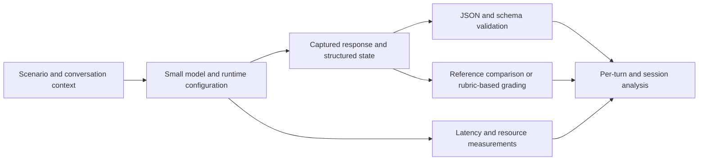
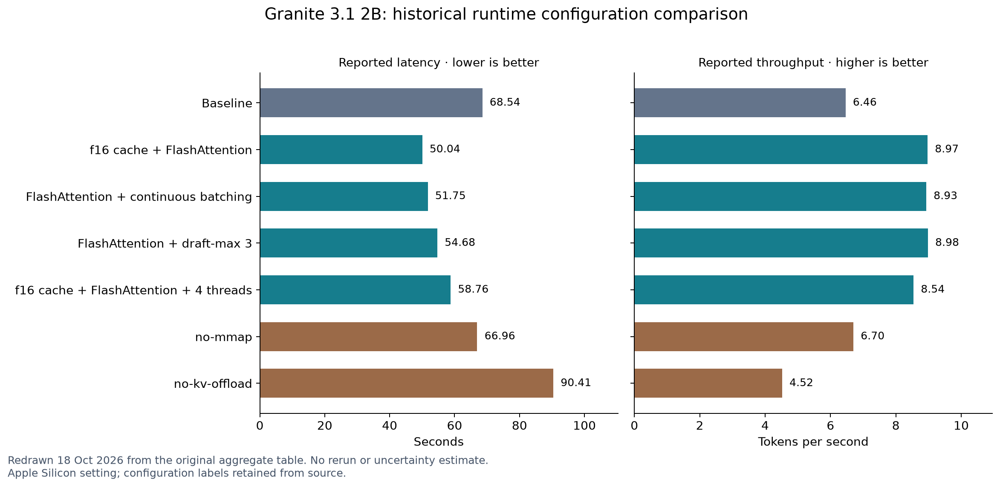
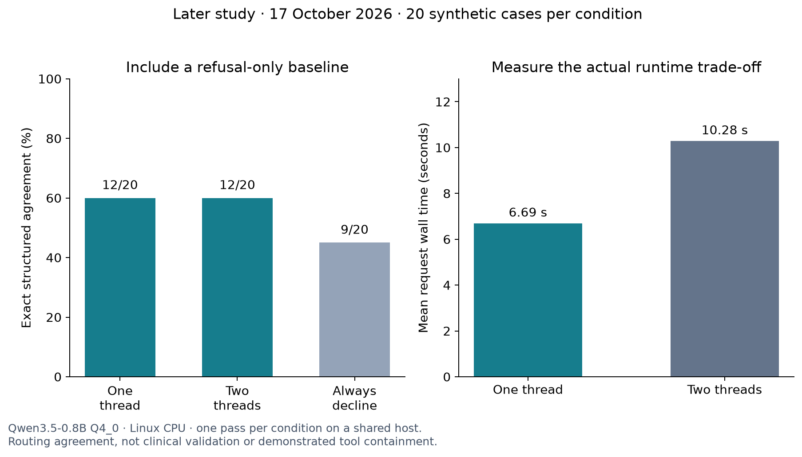

# Evaluating Small Language Models for On-Device Medical Information Collection

**Maria Magdalena Jastrzębska · Master’s thesis research, 2025–2026 · Defended April 2026**

Most of this work was carried out in **2025**. This repository publishes the research summary in **October 2026**, with a retrospective assessment and clearly separated post-thesis follow-up studies.


## Expanded research dossier

This repository now includes a detailed account of the master's project, 34 original research/application images, two redrawn summary figures, source links, and an assessment in hindsight. Historical thesis work and later experiments are kept separate.

- [Detailed thesis report: architecture, evaluation, results, and limitations](docs/THESIS_REPORT.md)
- [Annotated gallery of 34 original figures](docs/FIGURE_GALLERY.md)
- [All 46 runtime configuration labels](docs/RUNTIME_CONFIGURATIONS.md)
- [Author repositories, pinned manuscript chapters, and upstream tools](docs/REPOSITORIES.md)
- [Research experience and relevance to the Anthropic Fellows Program](docs/RESEARCH_FIT.md)
- [Dates, lessons learned, and what I would do differently](docs/RETROSPECTIVE.md)

**Timeline:** most research and development took place in **2025**; the thesis was finalized in early 2026 and **defended in April 2026**. The summary was published here on 18 October 2026. August and October 2026 studies are subsequent work, not part of the defended thesis.

*Multi-turn evaluation, structured tool use, inference trade-offs, and the path toward safety evaluations for local agents.*

## Abstract

Can a small language model collect information reliably across a conversation while running within the constraints of a personal device? I investigated this question through a diabetes information-collection assistant, a Python evaluation framework, and experiments with small models and inference configurations. The work connects application engineering with empirical evaluation: responses must preserve supplied facts, request missing information, follow a structured output contract, and remain usable as conversation context grows.

This report brings together the original research and its subsequent development in Edge-LLM-Lab. The original work compared model behavior using reference-based and reference-free multi-turn evaluation, combined structural checks with an LLM judge, and examined runtime trade-offs on Apple Silicon. Later work added a clearer separation between response capture and grading, reproducible reports, and synthetic tests of instruction and action boundaries. The central lesson is that device feasibility, task reliability, and resistance to adversarial inputs require distinct evidence.

**Start with:** [evaluation methodology](#evaluating-a-conversation-rather-than-an-isolated-answer), [results](#results-runtime-configuration-changes-the-cost-of-an-answer), [safety and security](#what-this-work-contributes-to-ai-safety-and-security), or [code and provenance](#code-and-provenance).

## Motivation: from a useful application to a measurable question

The starting point was an application for people with diabetes. I wanted to explore whether a small local model could conduct an information-collection dialogue without requiring remote inference for every interaction. The intended task was to collect and structure information, rather than autonomously diagnose a condition or prescribe treatment.

Getting a model to execute was only the first step. A useful assistant also needs to retain previously supplied facts, distinguish unknown information from known information, ask appropriate follow-up questions, and avoid declaring a record complete prematurely. Those behaviors must be evaluated together with latency and memory use: a small model that loads successfully can still be unreliable or impractical in a multi-turn workflow.

Local execution provides an architectural opportunity to reduce transmission of sensitive input. It does not by itself establish privacy or security: persistence, logs, dependencies, tool permissions, and access to the device remain relevant. The application’s local inference path must also be distinguished from research infrastructure that uses a remote model for reference generation or grading.

## My contributions

- Built a Flutter prototype and an agent workflow for collecting structured medical information, with a coordinator, specialized agent roles, conversation state, and schema-defined outputs.
- Developed a Python harness for evaluating complete multi-turn scenarios, including reference-based replay and reference-free assessment.
- Combined JSON/schema checks, reference-comparison metrics, and a rubric-based LLM judge with per-turn response and performance logging.
- Investigated model and runtime choices, including weight precision, threading, GPU offload, FlashAttention, cache configuration, and speculative decoding.
- Connected experiment tracking and saved artifacts to comparative analysis, then continued developing the evaluation infrastructure in Edge-LLM-Lab.

The evaluated workflow centered on information collection, particularly the `ConstantDataAgent`. A modular multi-agent application architecture does not imply that every possible agent role or a general multi-agent system was experimentally validated.

## Evaluating a conversation rather than an isolated answer

The agent updates structured state over successive turns. Its contract includes collected information, missing information or follow-up questions, and a completion status. This makes errors observable at several levels: malformed output, an incorrect field, loss of earlier context, an inappropriate question, or a premature completion decision.



### Two complementary evaluation modes

**Reference-based evaluation** uses prepared conversations and expected responses. The original references were developed interactively using a larger model, with manually supplied patient replies and manual review and correction. Each tested response is compared against its reference using structural, textual, semantic, and judge-based measures. Frozen conversation prefixes make comparisons easier, but they do not show how the model recovers from its own earlier mistakes.

**Reference-free evaluation** assesses the developing interaction without a golden response for every turn. It examines adherence to the task rules, progress toward completion, and behavior over the dialogue. This captures a different question from frozen replay, while introducing dependence on the scenario or simulator and the outcome rubric.

Both approaches use synthetic scenarios. Manually reviewed references and an LLM judge are useful research tools, but they are not equivalent to clinician-validated ground truth or a patient study.

### What was measured

| Layer | Measures used in the research | Interpretation |
| --- | --- | --- |
| Output contract | JSON validity and schema conformity | Can the application parse and accept the structure? |
| Reference agreement | Field/text comparison, including BLEU, ROUGE, METEOR, edit similarity, and BERTScore | How closely does the response match a chosen reference? |
| Behavioral quality | LLM-judge rubric | Does the response appear to satisfy the task and conversation requirements? |
| Interaction | Per-turn behavior, completion, and dialogue length | Does information collection progress as context accumulates? |
| Runtime | Latency, token throughput, memory, and available resource telemetry | What does the configuration cost on the measured hardware? |

The original judge rubric covered JSON correctness, tool-call correctness, reasoning logic, question naturalness, and context relevance. Here, “reasoning logic” means assessment of the model’s **written explanation**; it does not establish faithful access to its internal reasoning. Similarly, semantic similarity is not a substitute for checking exact medical values, units, or required actions.

## Results: runtime configuration changes the cost of an answer

The historical optimization table reports the following results for Granite 3.1 2B in an Apple Silicon evaluation setting. These are reported aggregate values from the original research, not newly rerun measurements or phone-wide performance guarantees.



| Configuration, as labeled in the original table | Latency (s) | Throughput (tokens/s) |
| --- | ---: | ---: |
| Baseline | 68.542 | 6.46 |
| f16 cache + FlashAttention | 50.038 | 8.97 |
| FlashAttention + continuous batching | 51.747 | 8.93 |
| FlashAttention + draft-max 3 | 54.679 | 8.98 |
| f16 cache + FlashAttention + 4 threads | 58.764 | 8.54 |
| no-mmap | 66.959 | 6.70 |
| no-kv-offload | 90.412 | 4.52 |

The f16-cache/FlashAttention configuration has **27.0% lower reported latency** and **38.9% higher reported throughput** than the baseline, calculated from these table values. The original table rounds the latter to 39.0%. Conversely, disabling KV offload is associated with worse performance in this comparison.

The result supports an engineering conclusion: runtime configuration deserves evaluation alongside model selection. It does not isolate the causal contribution of each optimization, and the aggregate table alone does not supply uncertainty intervals. “f16 cache” is retained as a configuration label; it should not be described as proof of a low-bit cache-quantization benefit.

The broader original analysis compared model families and weight-quantization settings using quality and resource measures. It distinguished the highest judge score from the configuration chosen as a practical compromise. I do not combine those model-selection results with the runtime table into a single ranking: the model versions, precision settings, and experimental conditions differ.

## A later extension: making boundary failures visible

On **17 October 2026**, Edge-LLM-Lab recorded a separate synthetic intake-routing study with Qwen3.5-0.8B Q4_0. Twenty cases covered supplied facts, missing units, contradictions, instruction overrides, unauthorized-action requests, and out-of-scope requests. The expected outputs were `record`, `clarify`, or `decline` under a frozen policy.



| Condition | Scored cases | Exact structured agreement | Mean request time |
| --- | ---: | ---: | ---: |
| One CPU thread | 20/20 | 12/20 (60%) | 6.69 s |
| Two CPU threads | 20/20 | 12/20 (60%) | 10.28 s |
| Always decline | 20 reference targets | 9/20 (45%) | No model execution |

This small study is useful because it exposes specific mismatches rather than hiding them behind a broad claim of safety. It also includes a simple baseline: refusing every request would already match nine targets. The observed 60% agreement should therefore be interpreted against 45%, not against zero.

The two-thread configuration was slower in this recorded run. The shared host, one pass per condition, correlated near-template cases, and lack of controlled warm-up or load prevent a general conclusion about thread counts. No real tools or treatments were executed; agreement with the routing policy is not demonstrated enforcement of an authorization boundary.

Offline scoring reproduced the 40 captured inline scores without generating new responses. An Inspect AI replay also reported 0.600 agreement on those same captures. This checks consistency across evaluation paths, not independent replication of model performance.

## What this work contributes to AI safety and security

The strongest connection to safety is the evaluation infrastructure and the questions it makes testable. A valid JSON object can contain an invented fact. A plausible conversation can lose a critical detail. A model can refuse malicious instructions yet also refuse legitimate work. These outcomes need separate measurements.

**Data integrity across turns.** Information collection provides a concrete setting for testing omissions, unsupported additions, contradictory values, and premature completion. These are application-level failure modes with potential downstream consequences.

**Tool and instruction boundaries.** A schema constrains format; it does not establish that an action is authorized. The later synthetic cases begin examining instruction overrides and action selection. A stronger security evaluation must execute isolated mock tools and observe whether prohibited actions are actually blocked.

**Evaluation integrity.** The framework’s later development separates capture from grading, preserves failed or missing trials, and records configuration and artifact hashes. This makes it easier to distinguish model failure, measurement failure, and a changed evaluator. It also prevents a rewritten figure from silently becoming a new experimental claim.

**Privacy-aware deployment.** Local inference can reduce a particular data-transfer dependency. Whether the complete system protects data also depends on storage, logging, network access, and the surrounding application. Remote research graders must be considered separately from local deployment.

### Proposed next experiment: persistent authorization boundaries

I want to extend this work to ask: **does a local tool-using agent preserve authorization boundaries across a multi-turn workflow, including after misleading external content, tool errors, and retries?**

A controlled experiment would pair benign tasks with adversarial variants, use synthetic records and mock tools, and compare prompt-only restrictions with enforced tool permissions and human approval. Outcomes would include unauthorized actions, synthetic-data disclosure, legitimate task completion, clarification behavior, and runtime cost. A refusal would count as useful protection only in conjunction with preserved benign performance.

This can transfer to automotive support: an agent could interpret read-only diagnostic data and retrieved documentation while being prevented from taking consequential actions without approval. The transferable research object is the boundary between information, instructions, and permitted actions—not a claim that medical intake and vehicle diagnostics share the same risk model.

This experiment is **proposed future work**. This report does not claim completed self-replication experiments, automotive penetration testing, or demonstrated containment of autonomous cyber capabilities.

## Limitations and lessons for the next iteration

The original study is exploratory. Model and prompt selection, a limited scenario set, judge calibration, and shared reference-generation methods can influence rankings. Repeated turns are not independent patients. Matching the inference-engine family across a desktop harness and a mobile app does not guarantee identical behavior or timings.

LLM-judge scores should be accompanied by deterministic checks and targeted human review. A judge-based average should not obscure a critical field error. Clinical safety would require a separate, appropriately designed validation process.

The subsequent Edge Lab work also identified a prompt/schema mismatch in an August 2026 structured-decoding pilot: uppercase completion states in a prompt example conflicted with a lowercase schema. Comparisons affected by that mismatch cannot support a clean claim about constrained versus unconstrained validity. This is a concrete example of why auditing the evaluation contract matters as much as scoring the model.

Federated adaptation was an explored direction, not a completed federated-learning experiment reported here. The application repository retains dormant foundations for future work. I do not claim measured differential-privacy guarantees or deployed federated training.

## Research timeline

| Date or period | Evidence and scope |
| --- | --- |
| 2025 | Most thesis research and development took place during this year. |
| 8 October 2025 | Historical experiment figure filenames carry this timestamp. This is artifact provenance, not proof of the project’s exact start date. |
| 17 January–23 February 2026 | Available manuscript Git history spans the initial import and subsequent revisions. Import dates do not date all underlying experiments. |
| April 2026 | Master’s thesis defended. |
| 10 August 2026 onward | Repository records document separation of the mobile application from its maintained evaluation laboratory and subsequent methodology work. |
| 17 October 2026 | Later synthetic routing/thread study and capture/scoring/Inspect integration reports. |
| 18 October 2026 | This retrospective research report and redrawn summary figures were prepared. Historical experiments were not rerun for this article. |

The underlying academic work received a **5.0/5.0 assessment**, as reported by the author. This article is a research report synthesizing that work and clearly dated subsequent development.

## Code and provenance

- [Edge-LLM-Lab](https://github.com/MariaJastrzebska/edge-llm-lab): maintained evaluation framework, datasets, reporting, and integration code.
- [Mobile application](https://github.com/MariaJastrzebska/fed-mobile): Flutter application and local-inference integration.
- [Current result galleries](https://github.com/MariaJastrzebska/edge-llm-lab/blob/d871920a363acb46a9fb2574f9d5e3fae1d71960/docs/research/current-reports.md): detailed protocols and limitations for later work.
- [Evaluation boundaries](https://github.com/MariaJastrzebska/edge-llm-lab/blob/d871920a363acb46a9fb2574f9d5e3fae1d71960/docs/methodology/evaluation-boundaries.md): capture versus scoring, device execution, and safety interpretation.
- [Evidence ledger](PROVENANCE.md): source revisions, historical numeric provenance, and the distinction between completed work and proposed research.
- [Plot data](data/runtime.csv) and [figure-generation script](scripts/render_figures.py): the historical table is transcribed explicitly; the later study uses its saved aggregate report values.

To regenerate the two summary figures:

```bash
python -m pip install matplotlib
python scripts/render_figures.py
```

These commands render saved aggregate values; they do not launch a model, contact a tracking service, or repeat an experiment.

## Conclusion

The main contribution is an experimental bridge between a small local model and the application that relies on it. Multi-turn traces, structured contracts, reference comparisons, behavioral grading, and runtime measurements make different failure modes visible. Extending that foundation toward explicit adversarial cases and enforced action boundaries offers a practical route from application reliability work to agent safety and security research.

## Lessons learned, in hindsight

The project is strongest as research engineering: connecting a local agent prototype to a task-specific evaluator and systems measurements. Its original evidence is narrower than claims of clinical reliability, guaranteed privacy, or a universal optimization mechanism. A stronger next study would validate the task contract, prioritize correct end-to-end behavior, include simple baselines, and repeat controlled measurements on the target device.

Read the [dated retrospective and proposed author reflection](docs/RETROSPECTIVE.md) for the complete assessment and a concrete redesign of the study.
