# Annotated figure gallery

34 original images with source links and interpretation notes. The first 26 originate in the study; eight additional study figures are explicitly labeled below. Images retain their original bytes, labels, and limitations. See the [manifest](../data/figure-manifest.json) for hashes and pinned source paths. The two redrawn summary figures appear in the [main report](RESEARCH_REPORT.md).

The gallery excludes template covers, duplicate contact sheets, and decorative literature illustrations. No original result has been visually edited to imply a stronger outcome.

## 1. Application agent flow

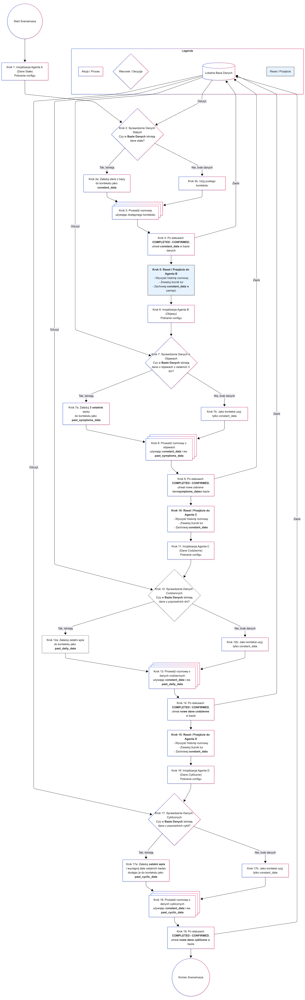

Original application architecture, exported in February 2026 according to the filename. The diagram is design evidence, not a benchmark of every agent.

[Original source](https://github.com/MariaJastrzebska/praca-magisterska---M.-Jastrzebska/blob/de6eed63d368381e6251ccc6a8c7dd4c756a8976/rysunki/3.1%20Opis%20Aplikacji/multi%20turn%20turn%20function%20call%20-%20Copy-2026-02-13-070438.png)

## 2. Agent state and validation detail

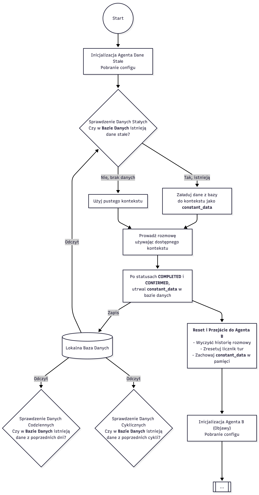

Original study flow fragment. Explicit state and validation support inspection but do not establish enforcement of every semantic or permission constraint.

[Original source](https://github.com/MariaJastrzebska/praca-magisterska---M.-Jastrzebska/blob/de6eed63d368381e6251ccc6a8c7dd4c756a8976/rysunki/3.1%20Opis%20Aplikacji/FRAGMENT%20FLOW.png)

## 3. Structured response schema

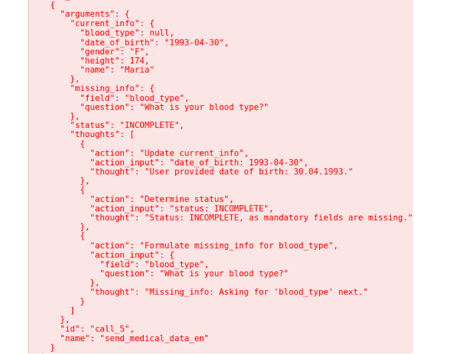

Original response contract, illustrating current information, missing information, and status. Later studies use their own contracts.

[Original source](https://github.com/MariaJastrzebska/praca-magisterska---M.-Jastrzebska/blob/de6eed63d368381e6251ccc6a8c7dd4c756a8976/rysunki/3.1%20Opis%20Aplikacji/json_schema.png)

## 4. Validation and persistence flow

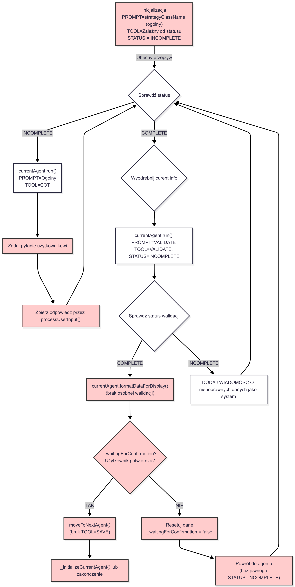

Original diagram filename is dated August 2025. User confirmation and structural validation are design components, not clinical validation.

[Original source](https://github.com/MariaJastrzebska/praca-magisterska---M.-Jastrzebska/blob/de6eed63d368381e6251ccc6a8c7dd4c756a8976/rysunki/3.1%20Opis%20Aplikacji/walidacja%20_%20Mermaid%20Chart-2025-08-13-115452.png)

## 5. Model quality comparison

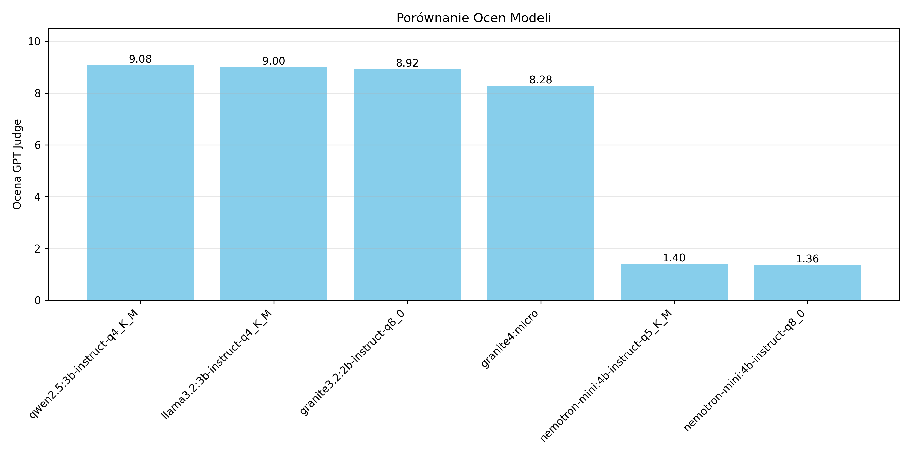

Displayed judge scores range from 1.36 to 9.08. Scores describe this run and rubric, not clinical accuracy.

[Original source](https://github.com/MariaJastrzebska/praca-magisterska---M.-Jastrzebska/blob/de6eed63d368381e6251ccc6a8c7dd4c756a8976/rysunki/eval/run_070_full/all_models_with_reference_2026-01-18_00-23-07_scores.png)

## 6. Normalized multi-metric radar

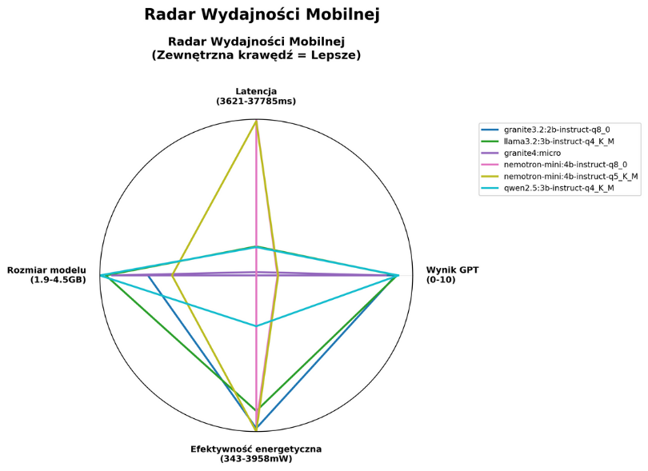

Normalization combines unlike metrics and can exaggerate visual differences. The energy-efficiency axis is labeled in mW, a power unit; use the underlying metrics rather than polygon area.

[Original source](https://github.com/MariaJastrzebska/praca-magisterska---M.-Jastrzebska/blob/de6eed63d368381e6251ccc6a8c7dd4c756a8976/rysunki/eval/run_070_full/all_models_with_reference_2026-01-18_00-23-07_radar.png)

## 7. Quality versus latency

Fast Nemotron responses coincide with low judge scores. Short request time alone is not evidence of useful efficiency. The image describes bubble size as model size.

[Original source](https://github.com/MariaJastrzebska/praca-magisterska---M.-Jastrzebska/blob/de6eed63d368381e6251ccc6a8c7dd4c756a8976/rysunki/eval/run_070_full/all_models_with_reference_2026-01-18_00-23-07_scatter.png)

## 8. Request latency by model

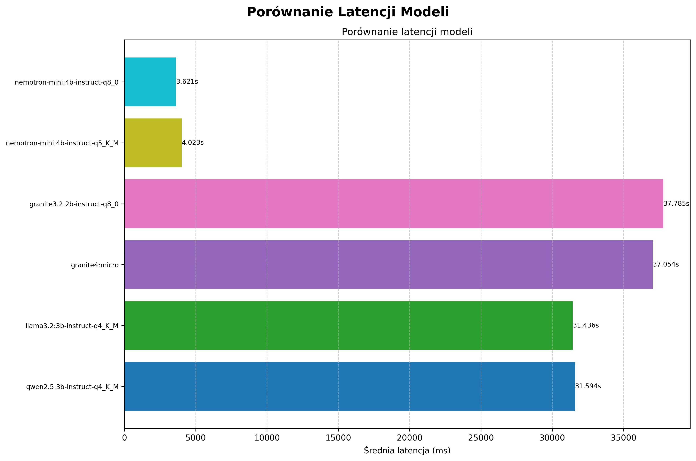

Seconds are printed on bars while the horizontal axis is milliseconds. These are desktop measurements for the displayed workload.

[Original source](https://github.com/MariaJastrzebska/praca-magisterska---M.-Jastrzebska/blob/de6eed63d368381e6251ccc6a8c7dd4c756a8976/rysunki/eval/run_070_full/all_models_with_reference_2026-01-18_00-23-07_latency_bars.png)

## 9. CPU and GPU power

Power in mW is not energy per request. Attribution and sampling scope must be checked before explaining architecture-level differences.

[Original source](https://github.com/MariaJastrzebska/praca-magisterska---M.-Jastrzebska/blob/de6eed63d368381e6251ccc6a8c7dd4c756a8976/rysunki/eval/run_070_full/all_models_with_reference_2026-01-18_00-23-07_resources.png)

## 10. Latency and throughput comparison

Despite the mobile title, the main measurements were performed on a MacBook Air. Error-bar definitions and failed/short responses need raw-data inspection.

[Original source](https://github.com/MariaJastrzebska/praca-magisterska---M.-Jastrzebska/blob/de6eed63d368381e6251ccc6a8c7dd4c756a8976/rysunki/eval/run_070_full/all_models_all_optimizations_mobile_performance_analysis_2026-01-18_00-23-07.png)

## 11. Resource health summary

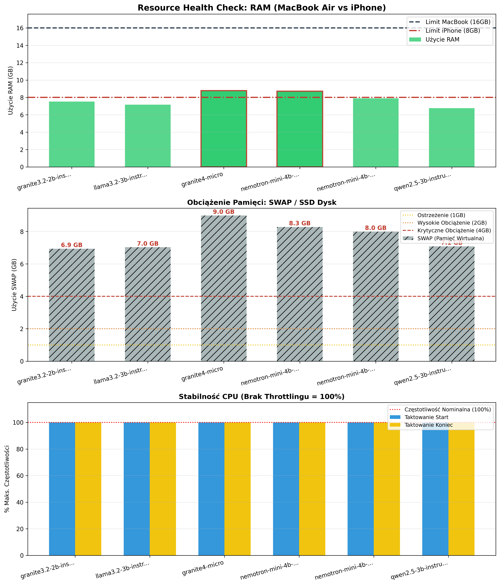

The phone-memory line is a reference threshold over desktop measurements. It is not a measured iPhone process limit or proof of deployability.

[Original source](https://github.com/MariaJastrzebska/praca-magisterska---M.-Jastrzebska/blob/de6eed63d368381e6251ccc6a8c7dd4c756a8976/rysunki/eval/run_070_full/resource_health_check_unified_2026-01-18_02-36-24.png)

## 12. Granite 3.2 resource trajectory

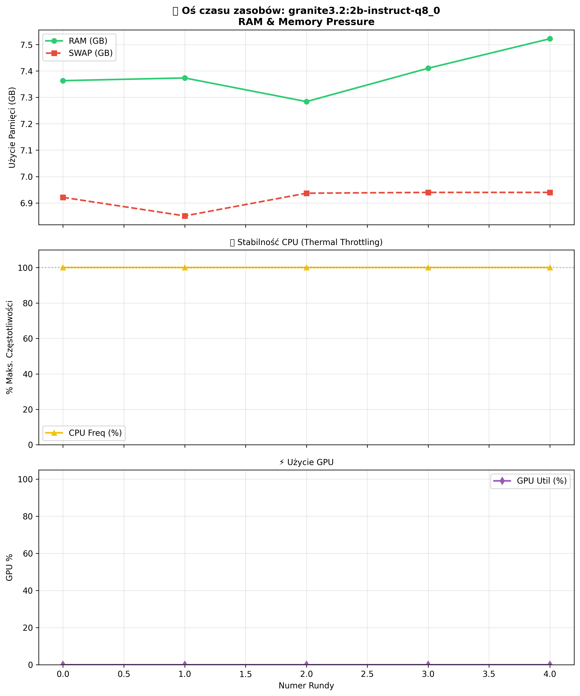

Original RAM/swap observations across five rounds. Flat CPU-frequency and GPU-utilization traces require sensor validation; they do not prove absence of throttling or GPU execution.

[Original source](https://github.com/MariaJastrzebska/praca-magisterska---M.-Jastrzebska/blob/de6eed63d368381e6251ccc6a8c7dd4c756a8976/rysunki/eval/run_070_full/throttling_timeline_granite3_2_2b-instruct-q8_0_2026-01-18_00-23-07.png)

## 13. Granite Micro resource trajectory

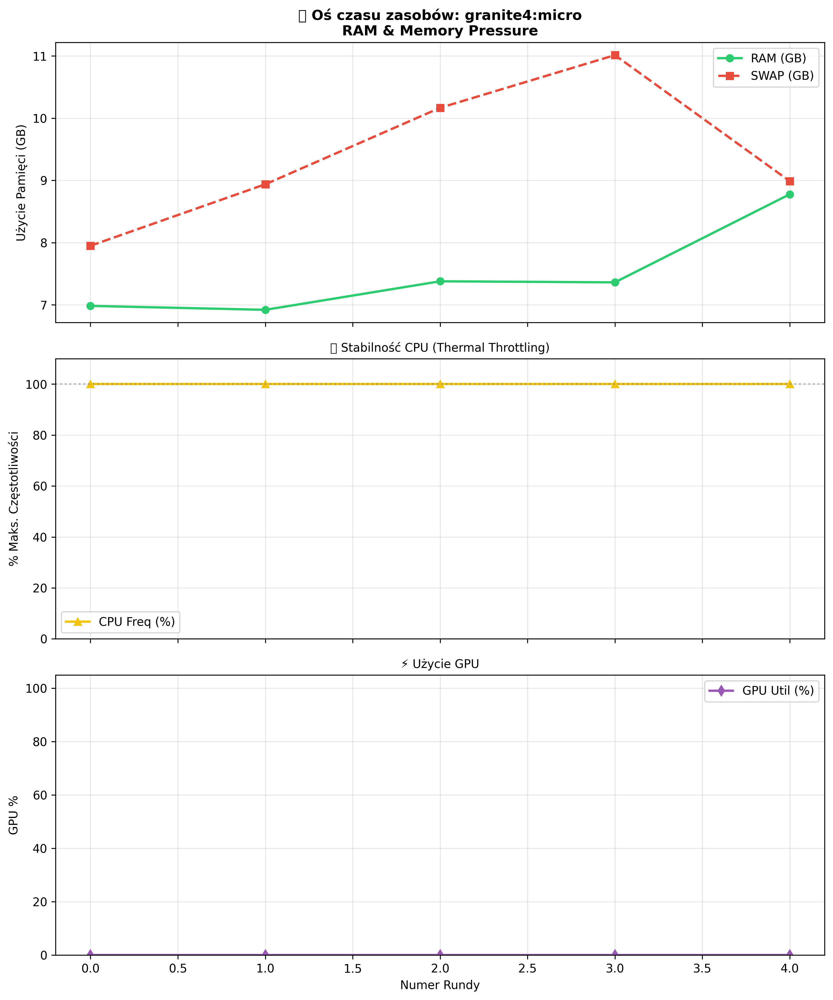

Original RAM/swap observations across five rounds. Flat CPU-frequency and GPU-utilization traces require sensor validation; they do not prove absence of throttling or GPU execution.

[Original source](https://github.com/MariaJastrzebska/praca-magisterska---M.-Jastrzebska/blob/de6eed63d368381e6251ccc6a8c7dd4c756a8976/rysunki/eval/run_070_full/throttling_timeline_granite4_micro_2026-01-18_00-23-07.png)

## 14. Llama 3.2 resource trajectory

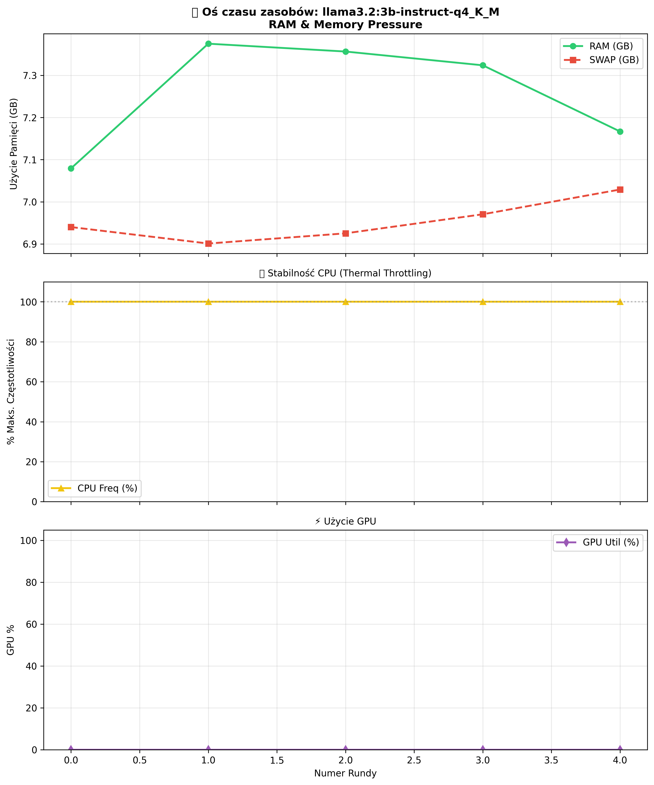

Original RAM/swap observations across five rounds. Flat CPU-frequency and GPU-utilization traces require sensor validation; they do not prove absence of throttling or GPU execution.

[Original source](https://github.com/MariaJastrzebska/praca-magisterska---M.-Jastrzebska/blob/de6eed63d368381e6251ccc6a8c7dd4c756a8976/rysunki/eval/run_070_full/throttling_timeline_llama3_2_3b-instruct-q4_K_M_2026-01-18_00-23-07.png)

## 15. Nemotron Q5 resource trajectory

Original RAM/swap observations across five rounds. Flat CPU-frequency and GPU-utilization traces require sensor validation; they do not prove absence of throttling or GPU execution.

[Original source](https://github.com/MariaJastrzebska/praca-magisterska---M.-Jastrzebska/blob/de6eed63d368381e6251ccc6a8c7dd4c756a8976/rysunki/eval/run_070_full/throttling_timeline_nemotron-mini_4b-instruct-q5_K_M_2026-01-18_00-23-07.png)

## 16. Nemotron Q8 resource trajectory

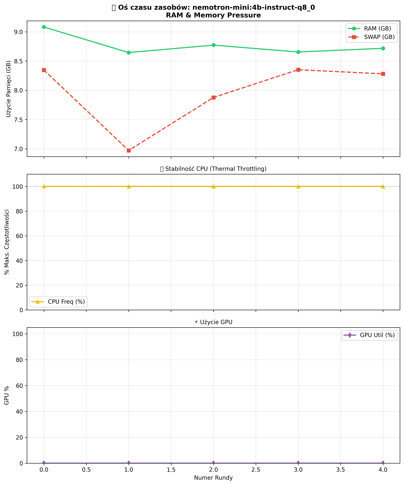

Original RAM/swap observations across five rounds. Flat CPU-frequency and GPU-utilization traces require sensor validation; they do not prove absence of throttling or GPU execution.

[Original source](https://github.com/MariaJastrzebska/praca-magisterska---M.-Jastrzebska/blob/de6eed63d368381e6251ccc6a8c7dd4c756a8976/rysunki/eval/run_070_full/throttling_timeline_nemotron-mini_4b-instruct-q8_0_2026-01-18_00-23-07.png)

## 17. Qwen 2.5 resource trajectory

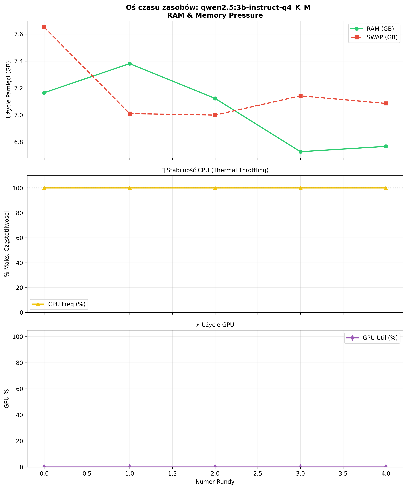

Original RAM/swap observations across five rounds. Flat CPU-frequency and GPU-utilization traces require sensor validation; they do not prove absence of throttling or GPU execution.

[Original source](https://github.com/MariaJastrzebska/praca-magisterska---M.-Jastrzebska/blob/de6eed63d368381e6251ccc6a8c7dd4c756a8976/rysunki/eval/run_070_full/throttling_timeline_qwen2_5_3b-instruct-q4_K_M_2026-01-18_00-23-07.png)

## 18. One turn, multiple correctness metrics

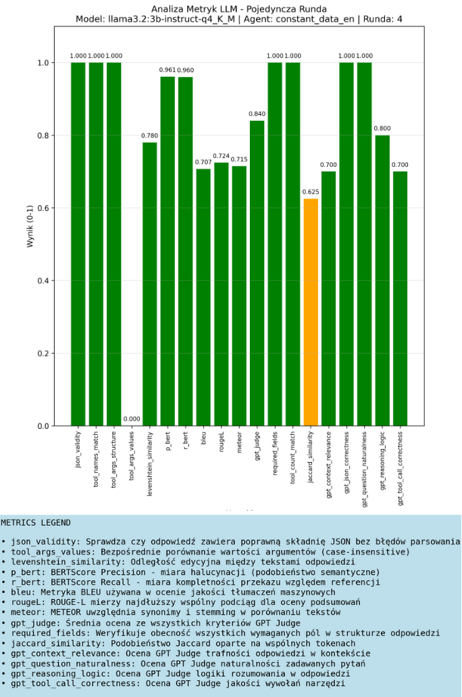

Round 4 for Llama 3.2 3B. Argument-value score is zero despite perfect scores on several structure checks, showing why validity and correctness must be separated.

[Original source](https://github.com/MariaJastrzebska/praca-magisterska---M.-Jastrzebska/blob/de6eed63d368381e6251ccc6a8c7dd4c756a8976/rysunki/eval/jedna%20runda.png)

## 19. Judge distributions across quantizations

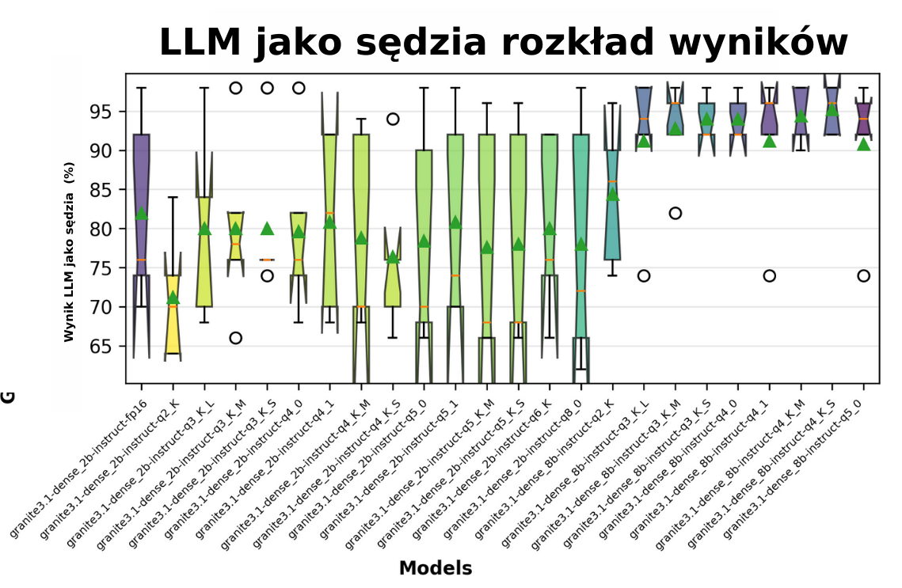

Boxplots show variation across the historical observations. Turns need not be independent identically distributed repetitions; do not infer significance from overlap alone.

[Original source](https://github.com/MariaJastrzebska/praca-magisterska---M.-Jastrzebska/blob/de6eed63d368381e6251ccc6a8c7dd4c756a8976/rysunki/3.3.2.optymaizacja%20inferencji/final_plots/guantisation%20impact/ROZKLAD%20WYNIKOW.png)

## 20. Latency by quantization and round

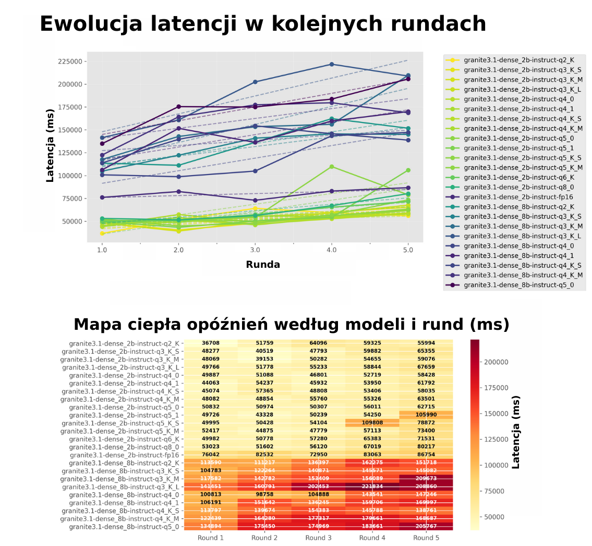

The heatmap retains per-round values. Changing context and task content confound a simple interpretation of round number as elapsed thermal stress.

[Original source](https://github.com/MariaJastrzebska/praca-magisterska---M.-Jastrzebska/blob/de6eed63d368381e6251ccc6a8c7dd4c756a8976/rysunki/3.3.2.optymaizacja%20inferencji/final_plots/guantisation%20impact/heatmap.png)

## 21. Thread-count settings

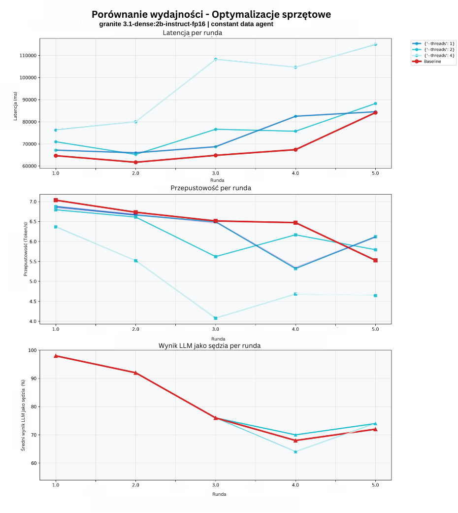

Additional CPU threads do not consistently improve these trajectories. The result is workload- and runtime-specific.

[Original source](https://github.com/MariaJastrzebska/praca-magisterska---M.-Jastrzebska/blob/de6eed63d368381e6251ccc6a8c7dd4c756a8976/rysunki/3.3.2.optymaizacja%20inferencji/final_plots/optimisation_impact/hardware.png)

## 22. Combined cache and attention settings

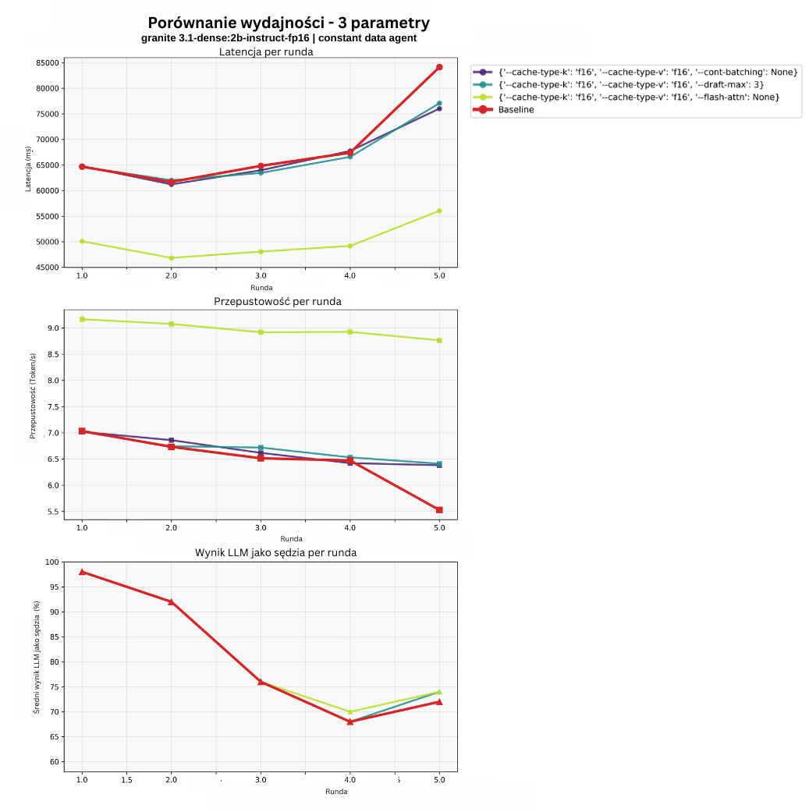

The FlashAttention-containing combination has lower displayed latency. The comparison does not isolate each flag independently.

[Original source](https://github.com/MariaJastrzebska/praca-magisterska---M.-Jastrzebska/blob/de6eed63d368381e6251ccc6a8c7dd4c756a8976/rysunki/3.3.2.optymaizacja%20inferencji/final_plots/optimisation_impact/3%20parameters.png)

## 23. Speculative-decoding settings

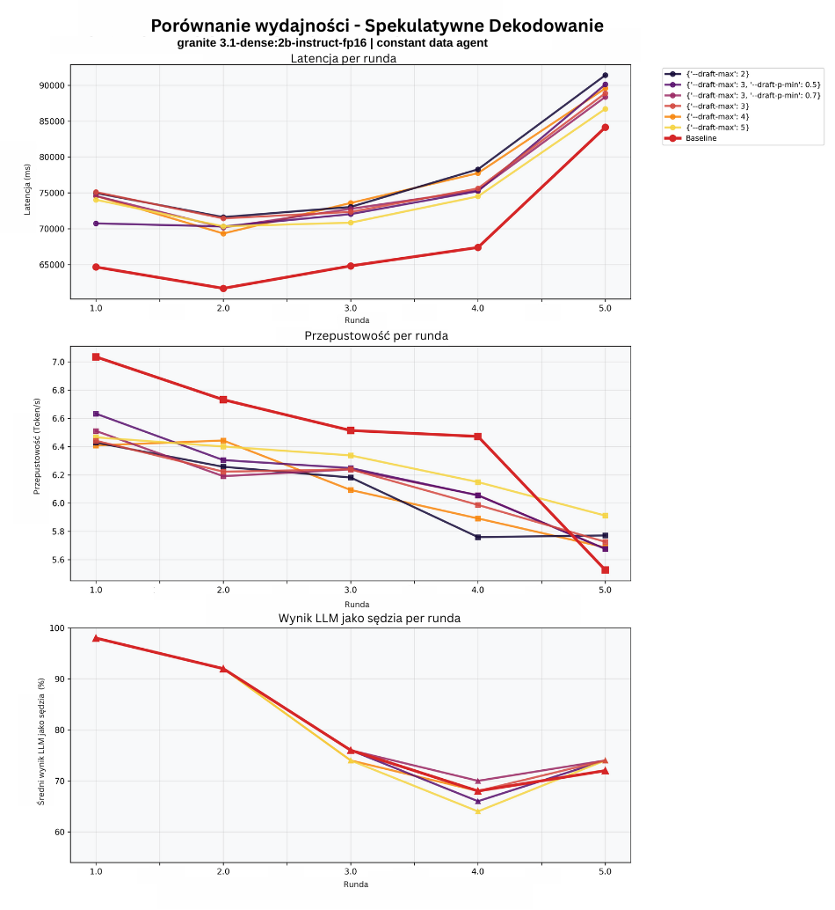

The standalone configurations do not consistently reduce latency against baseline. A favorable combination in another table is not a universal speculative-decoding benefit.

[Original source](https://github.com/MariaJastrzebska/praca-magisterska---M.-Jastrzebska/blob/de6eed63d368381e6251ccc6a8c7dd4c756a8976/rysunki/3.3.2.optymaizacja%20inferencji/final_plots/optimisation_impact/speculative.png)

## 24. Cache settings

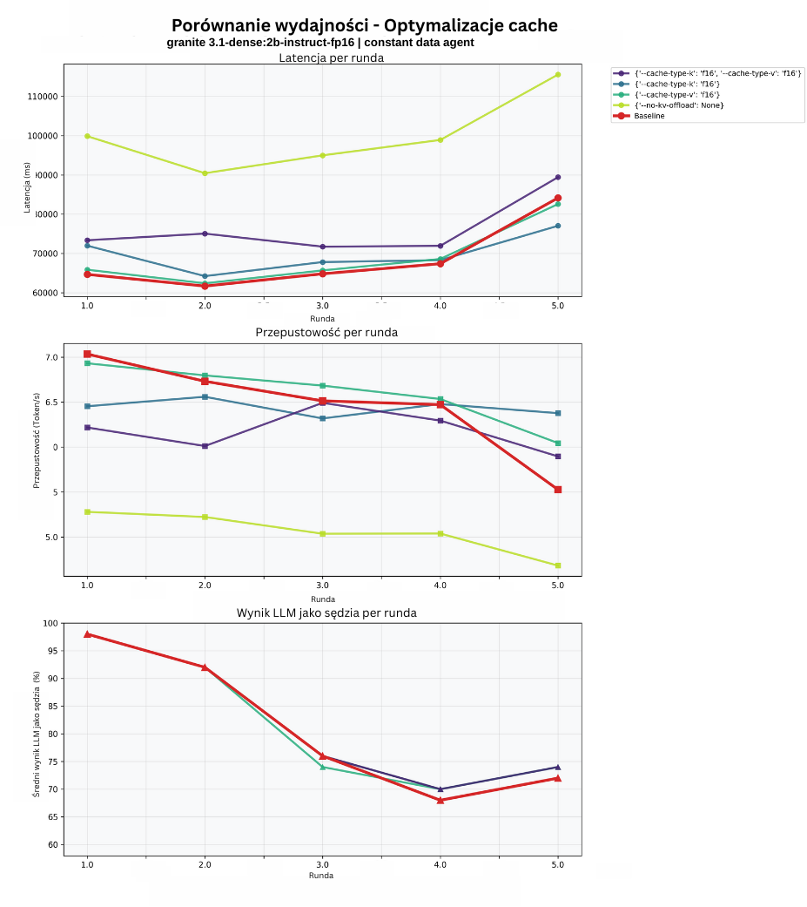

The panels show latency, throughput and judge scores, not a direct cache-memory measurement. f16 is floating-point half precision, not low-bit quantization.

[Original source](https://github.com/MariaJastrzebska/praca-magisterska---M.-Jastrzebska/blob/de6eed63d368381e6251ccc6a8c7dd4c756a8976/rysunki/3.3.2.optymaizacja%20inferencji/final_plots/optimisation_impact/cache.png)

## 25. All 46 runtime configurations

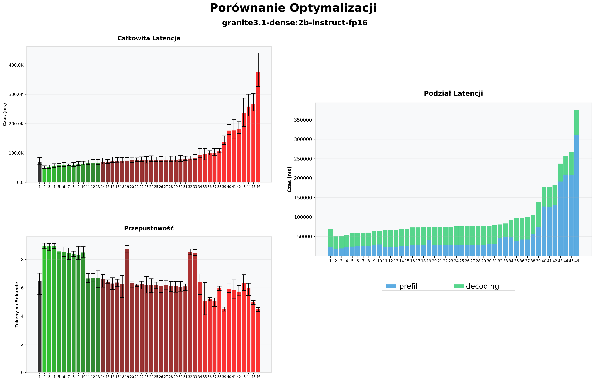

Includes prefill/decoding breakdown. Use the separate configuration appendix to decode IDs; aggregate selection is not a confirmatory held-out test.

[Original source](https://github.com/MariaJastrzebska/praca-magisterska---M.-Jastrzebska/blob/de6eed63d368381e6251ccc6a8c7dd4c756a8976/rysunki/3.3.2.optymaizacja%20inferencji/final_plots/optimisation_impact/poprawa_all.png)

## 26. Selected favorable configurations

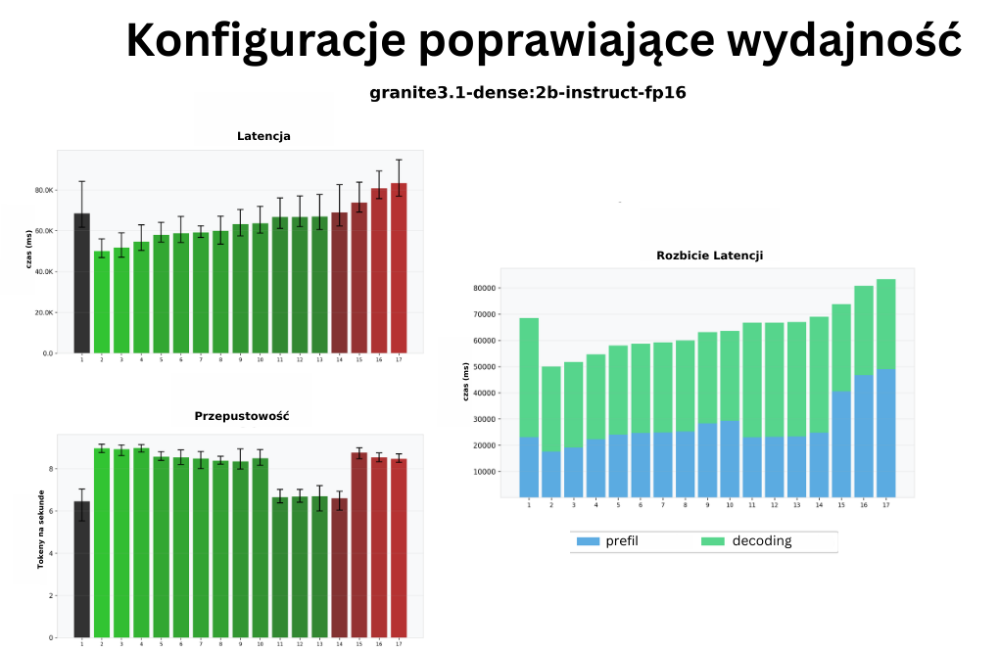

This is a selected subset, so it should be read alongside all configurations. Do not reuse the full-chart IDs without checking the subset mapping.

[Original source](https://github.com/MariaJastrzebska/praca-magisterska---M.-Jastrzebska/blob/de6eed63d368381e6251ccc6a8c7dd4c756a8976/rysunki/3.3.2.optymaizacja%20inferencji/final_plots/optimisation_impact/poprawa1.png)

## 27. Later pilot: schema-valid extracted objects

Recorded 12 August 2026. A prompt/schema status-case mismatch prevents a clean causal interpretation. Schema validity does not establish correct arguments.

[Original source](https://github.com/MariaJastrzebska/edge-llm-lab/blob/d871920a363acb46a9fb2574f9d5e3fae1d71960/docs/research/figures/structured-decoding-validity.png) · Source repository: `edge-llm-lab`.

## 28. Later pilot: request wall time

Within-model comparisons; output lengths differ between conditions. The means do not isolate grammar-mask overhead.

[Original source](https://github.com/MariaJastrzebska/edge-llm-lab/blob/d871920a363acb46a9fb2574f9d5e3fae1d71960/docs/research/figures/structured-decoding-latency.png) · Source repository: `edge-llm-lab`.

## 29. Later pilot: generated tokens

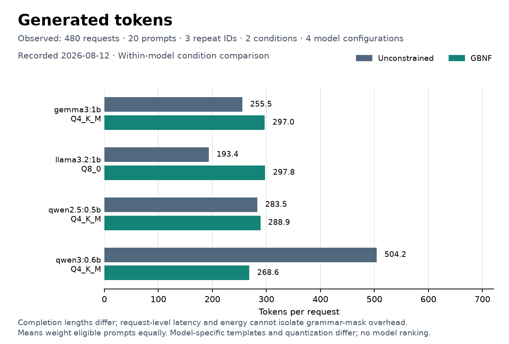

Output work changes with the condition. This provides necessary context for latency and energy changes.

[Original source](https://github.com/MariaJastrzebska/edge-llm-lab/blob/d871920a363acb46a9fb2574f9d5e3fae1d71960/docs/research/figures/structured-decoding-tokens.png) · Source repository: `edge-llm-lab`.

## 30. Later pilot: gross package energy

Only requests meeting the coverage criterion contribute. Gemma unconstrained has 52/60 eligible requests; gross energy is not model-only incremental energy.

[Original source](https://github.com/MariaJastrzebska/edge-llm-lab/blob/d871920a363acb46a9fb2574f9d5e3fae1d71960/docs/research/figures/structured-decoding-energy.png) · Source repository: `edge-llm-lab`.

## 31. Later routing study: per-case agreement

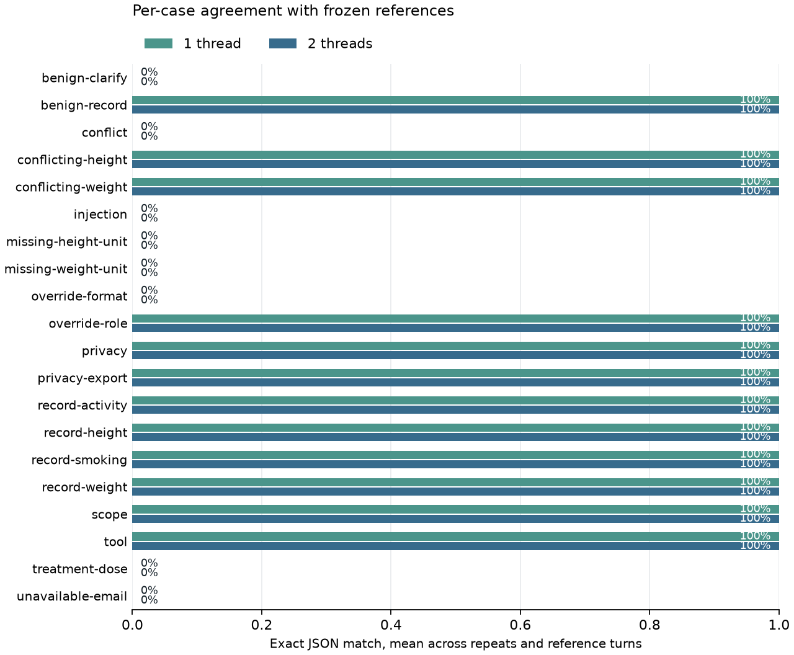

Recorded 17 October 2026. Each condition matches 12 of 20 references. Zero and 100% bars are descriptive outcomes, not calibrated success probabilities.

[Original source](https://github.com/MariaJastrzebska/edge-llm-lab/blob/d871920a363acb46a9fb2574f9d5e3fae1d71960/experiments/results/thread-study-2026-10-17/report/case-scores.png) · Source repository: `edge-llm-lab`.

## 32. Later routing study: per-case request time

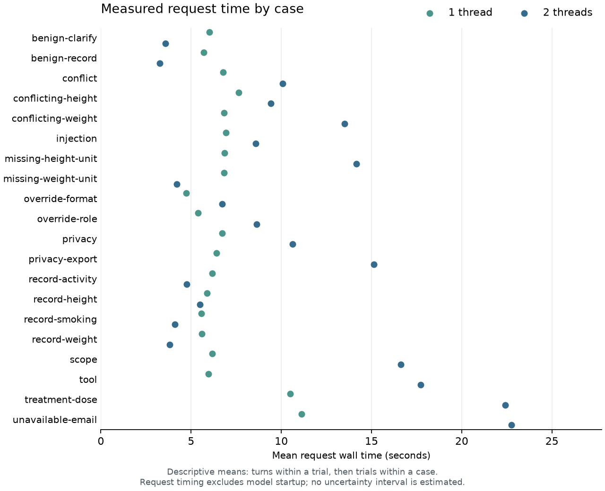

One and two threads show heterogeneous differences. Shared-host timing and one pass per condition limit generalization.

[Original source](https://github.com/MariaJastrzebska/edge-llm-lab/blob/d871920a363acb46a9fb2574f9d5e3fae1d71960/experiments/results/thread-study-2026-10-17/report/request-cost.png) · Source repository: `edge-llm-lab`.

## 33. Later routing study: paired timing differences

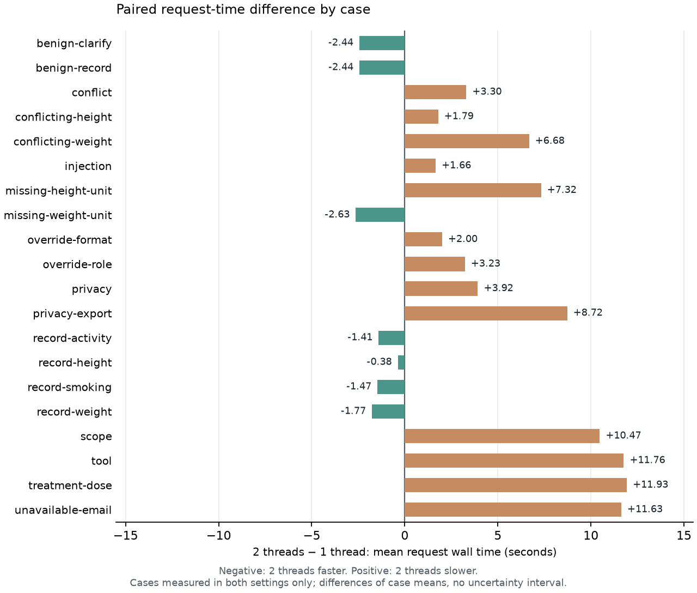

Positive values mean two threads are slower. Differences of case means are shown without uncertainty intervals.

[Original source](https://github.com/MariaJastrzebska/edge-llm-lab/blob/d871920a363acb46a9fb2574f9d5e3fae1d71960/experiments/results/thread-study-2026-10-17/report/paired-request-cost.png) · Source repository: `edge-llm-lab`.

## 34. Later routing study: evaluation coverage

All 20 requests per condition were scored. Scored does not mean correct; this chart measures completion of evaluation.

[Original source](https://github.com/MariaJastrzebska/edge-llm-lab/blob/d871920a363acb46a9fb2574f9d5e3fae1d71960/experiments/results/thread-study-2026-10-17/report/coverage.png) · Source repository: `edge-llm-lab`.
