# Annotated figure gallery

30 research charts with English labels and interpretation notes. Historical charts use vector text overlays over the unmodified source image; later charts already use English. The [translation manifest](../data/english-labels.json) records label regions and source hashes. Original PNGs remain archived for comparison. The full narrative and charts are available in the [single research article](../README.md).

The gallery excludes template covers, duplicate contact sheets, and decorative literature illustrations. No original result has been visually edited to imply a stronger outcome.

## 1. Model quality comparison

Displayed judge scores range from 1.36 to 9.08. Scores describe this run and rubric, not clinical accuracy.

[Archived original source](https://github.com/MariaJastrzebska/praca-magisterska---M.-Jastrzebska/blob/de6eed63d368381e6251ccc6a8c7dd4c756a8976/rysunki/eval/run_070_full/all_models_with_reference_2026-01-18_00-23-07_scores.png)

## 2. Normalized multi-metric radar

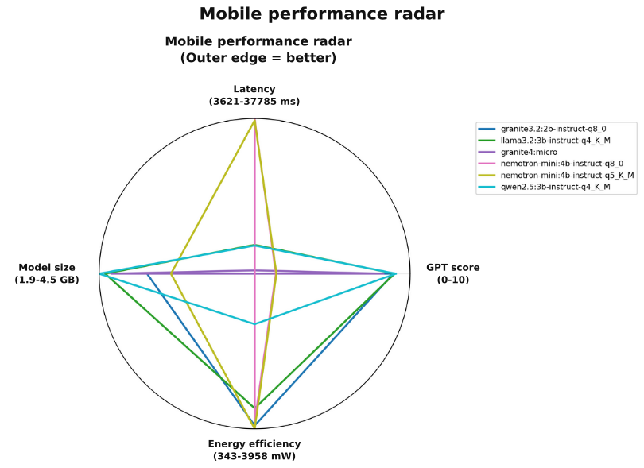

Normalization combines unlike metrics and can exaggerate visual differences. The energy-efficiency axis is labeled in mW, a power unit; use the underlying metrics rather than polygon area.

[Archived original source](https://github.com/MariaJastrzebska/praca-magisterska---M.-Jastrzebska/blob/de6eed63d368381e6251ccc6a8c7dd4c756a8976/rysunki/eval/run_070_full/all_models_with_reference_2026-01-18_00-23-07_radar.png)

## 3. Quality versus latency

Fast Nemotron responses coincide with low judge scores. Short request time alone is not evidence of useful efficiency. The image describes bubble size as model size.

[Archived original source](https://github.com/MariaJastrzebska/praca-magisterska---M.-Jastrzebska/blob/de6eed63d368381e6251ccc6a8c7dd4c756a8976/rysunki/eval/run_070_full/all_models_with_reference_2026-01-18_00-23-07_scatter.png)

## 4. Request latency by model

Seconds are printed on bars while the horizontal axis is milliseconds. These are desktop measurements for the displayed workload.

[Archived original source](https://github.com/MariaJastrzebska/praca-magisterska---M.-Jastrzebska/blob/de6eed63d368381e6251ccc6a8c7dd4c756a8976/rysunki/eval/run_070_full/all_models_with_reference_2026-01-18_00-23-07_latency_bars.png)

## 5. CPU and GPU power

The archived comparison aggregates post-request power samples in mW. These are not integrated request energy or average inference power, and do not establish battery life.

[Archived original source](https://github.com/MariaJastrzebska/praca-magisterska---M.-Jastrzebska/blob/de6eed63d368381e6251ccc6a8c7dd4c756a8976/rysunki/eval/run_070_full/all_models_with_reference_2026-01-18_00-23-07_resources.png)

## 6. Latency and throughput comparison

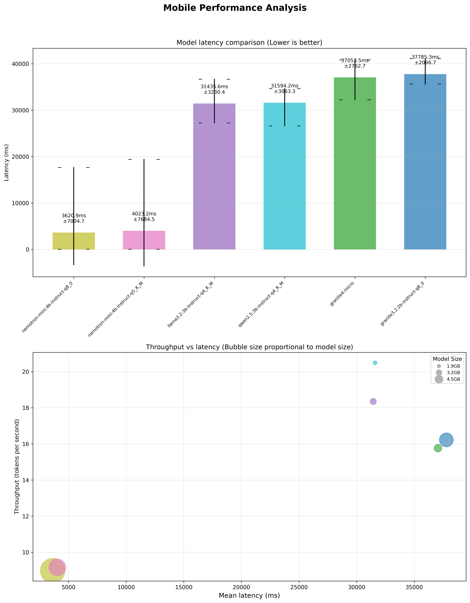

Despite the mobile title, the main measurements were performed on a MacBook Air. Error-bar definitions and failed/short responses need raw-data inspection.

[Archived original source](https://github.com/MariaJastrzebska/praca-magisterska---M.-Jastrzebska/blob/de6eed63d368381e6251ccc6a8c7dd4c756a8976/rysunki/eval/run_070_full/all_models_all_optimizations_mobile_performance_analysis_2026-01-18_00-23-07.png)

## 7. Resource health summary

The phone-memory line is a reference threshold over desktop measurements. It is not a measured iPhone process limit or proof of deployability.

[Archived original source](https://github.com/MariaJastrzebska/praca-magisterska---M.-Jastrzebska/blob/de6eed63d368381e6251ccc6a8c7dd4c756a8976/rysunki/eval/run_070_full/resource_health_check_unified_2026-01-18_02-36-24.png)

## 8. Granite 3.2 resource trajectory

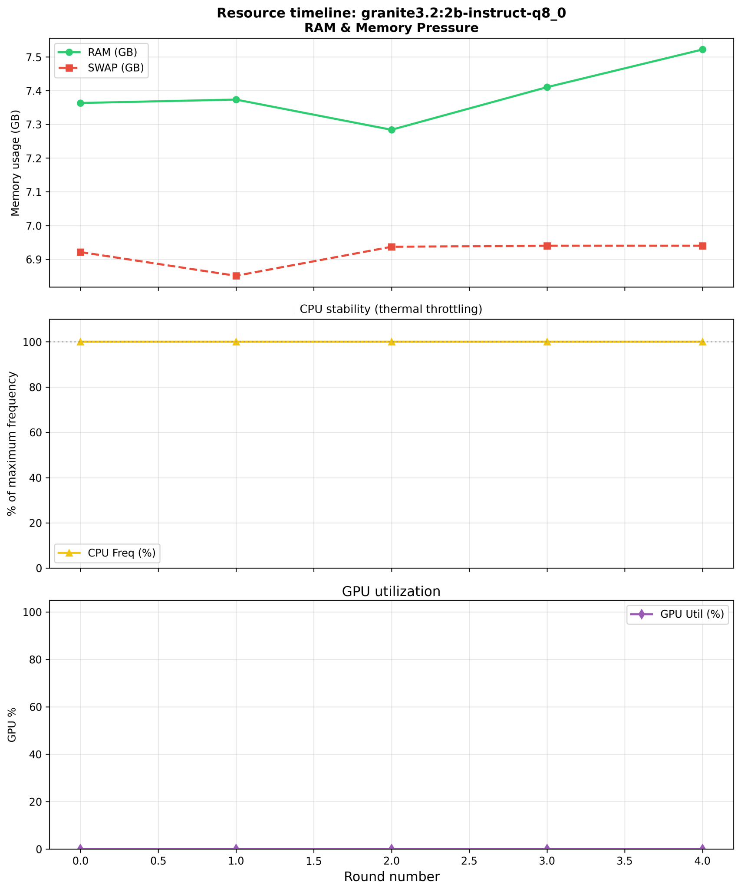

System-wide RAM/swap snapshots across five rounds. The GPU zero line reflects a missing-telemetry default in the archived plotting path; CPU snapshots cannot rule out within-request throttling.

[Archived original source](https://github.com/MariaJastrzebska/praca-magisterska---M.-Jastrzebska/blob/de6eed63d368381e6251ccc6a8c7dd4c756a8976/rysunki/eval/run_070_full/throttling_timeline_granite3_2_2b-instruct-q8_0_2026-01-18_00-23-07.png)

## 9. Granite Micro resource trajectory

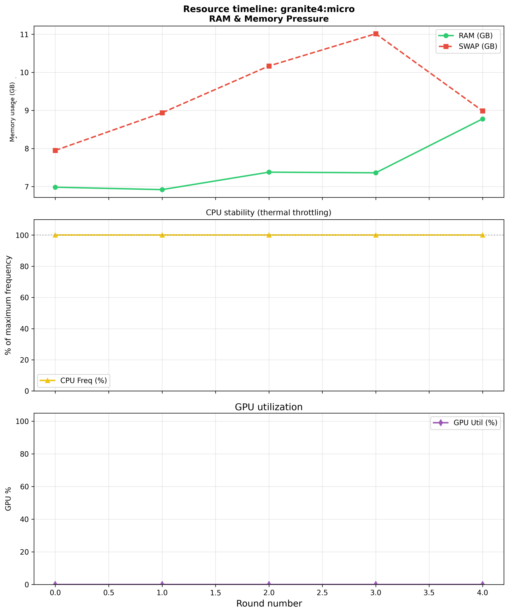

System-wide RAM/swap snapshots across five rounds. The GPU zero line reflects a missing-telemetry default in the archived plotting path; CPU snapshots cannot rule out within-request throttling.

[Archived original source](https://github.com/MariaJastrzebska/praca-magisterska---M.-Jastrzebska/blob/de6eed63d368381e6251ccc6a8c7dd4c756a8976/rysunki/eval/run_070_full/throttling_timeline_granite4_micro_2026-01-18_00-23-07.png)

## 10. Llama 3.2 resource trajectory

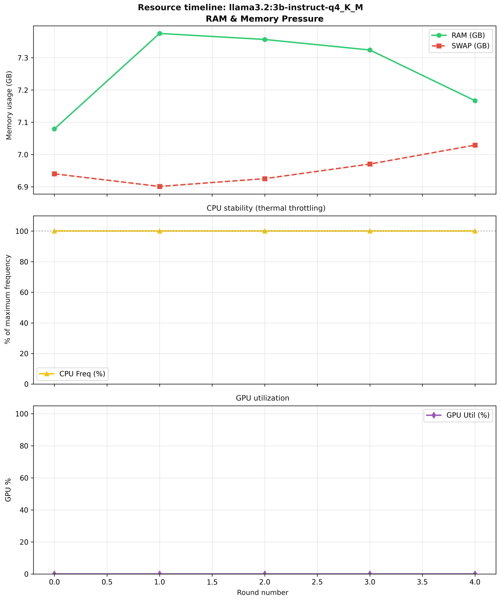

System-wide RAM/swap snapshots across five rounds. The GPU zero line reflects a missing-telemetry default in the archived plotting path; CPU snapshots cannot rule out within-request throttling.

[Archived original source](https://github.com/MariaJastrzebska/praca-magisterska---M.-Jastrzebska/blob/de6eed63d368381e6251ccc6a8c7dd4c756a8976/rysunki/eval/run_070_full/throttling_timeline_llama3_2_3b-instruct-q4_K_M_2026-01-18_00-23-07.png)

## 11. Nemotron Q5 resource trajectory

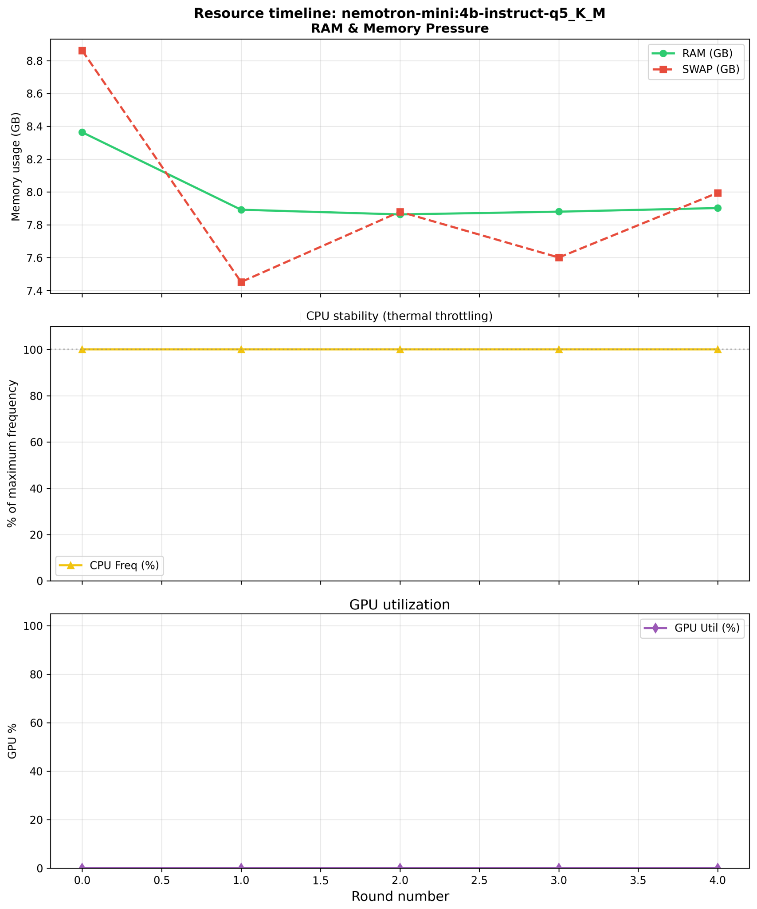

System-wide RAM/swap snapshots across five rounds. The GPU zero line reflects a missing-telemetry default in the archived plotting path; CPU snapshots cannot rule out within-request throttling.

[Archived original source](https://github.com/MariaJastrzebska/praca-magisterska---M.-Jastrzebska/blob/de6eed63d368381e6251ccc6a8c7dd4c756a8976/rysunki/eval/run_070_full/throttling_timeline_nemotron-mini_4b-instruct-q5_K_M_2026-01-18_00-23-07.png)

## 12. Nemotron Q8 resource trajectory

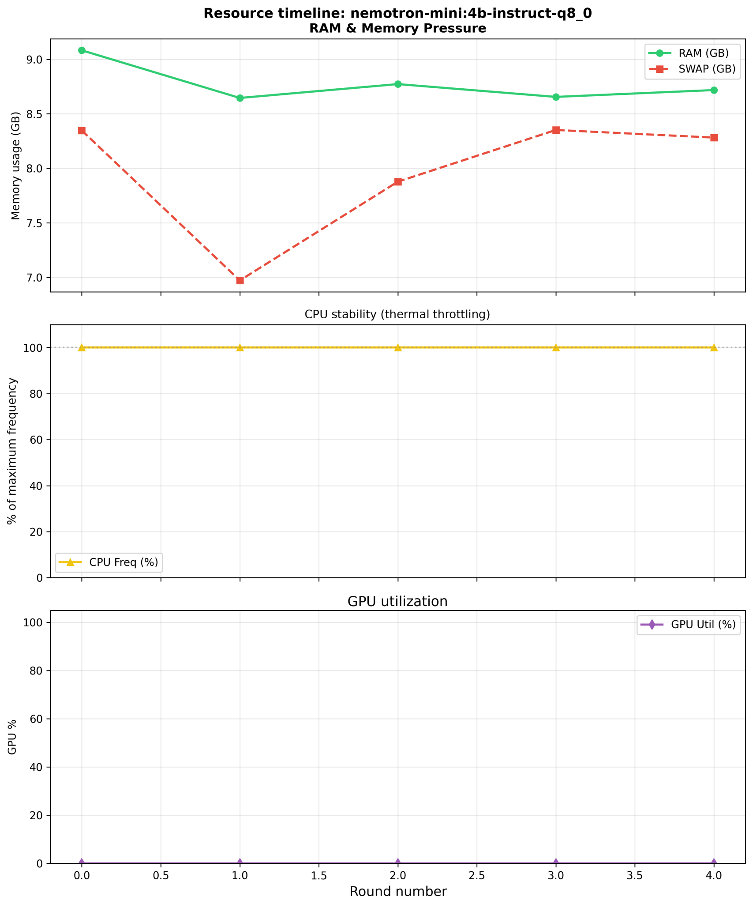

System-wide RAM/swap snapshots across five rounds. The GPU zero line reflects a missing-telemetry default in the archived plotting path; CPU snapshots cannot rule out within-request throttling.

[Archived original source](https://github.com/MariaJastrzebska/praca-magisterska---M.-Jastrzebska/blob/de6eed63d368381e6251ccc6a8c7dd4c756a8976/rysunki/eval/run_070_full/throttling_timeline_nemotron-mini_4b-instruct-q8_0_2026-01-18_00-23-07.png)

## 13. Qwen 2.5 resource trajectory

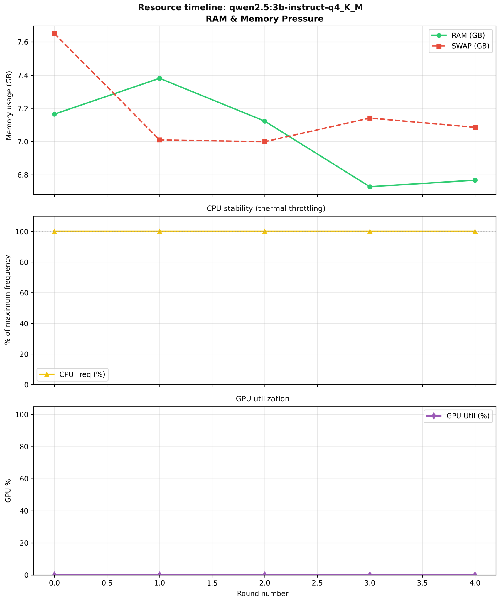

System-wide RAM/swap snapshots across five rounds. The GPU zero line reflects a missing-telemetry default in the archived plotting path; CPU snapshots cannot rule out within-request throttling.

[Archived original source](https://github.com/MariaJastrzebska/praca-magisterska---M.-Jastrzebska/blob/de6eed63d368381e6251ccc6a8c7dd4c756a8976/rysunki/eval/run_070_full/throttling_timeline_qwen2_5_3b-instruct-q4_K_M_2026-01-18_00-23-07.png)

## 14. One turn, multiple correctness metrics

Round 4 for Llama 3.2 3B. Argument-value agreement is zero beside perfect structural scores. The archived scorer can produce this pattern for identical nested tool calls, so the chart alone does not establish a wrong field value. See the [scorer limitation](RESEARCH_REPORT.md#metrics-have-different-meanings).

[Archived original source](https://github.com/MariaJastrzebska/praca-magisterska---M.-Jastrzebska/blob/de6eed63d368381e6251ccc6a8c7dd4c756a8976/rysunki/eval/jedna%20runda.png)

## 15. Judge distributions across quantizations

Boxplots show variation across the historical observations. Turns need not be independent identically distributed repetitions; do not infer significance from overlap alone.

[Archived original source](https://github.com/MariaJastrzebska/praca-magisterska---M.-Jastrzebska/blob/de6eed63d368381e6251ccc6a8c7dd4c756a8976/rysunki/3.3.2.optymaizacja%20inferencji/final_plots/guantisation%20impact/ROZKLAD%20WYNIKOW.png)

## 16. Latency by quantization and round

The heatmap retains per-round values. Changing context and task content confound a simple interpretation of round number as elapsed thermal stress.

[Archived original source](https://github.com/MariaJastrzebska/praca-magisterska---M.-Jastrzebska/blob/de6eed63d368381e6251ccc6a8c7dd4c756a8976/rysunki/3.3.2.optymaizacja%20inferencji/final_plots/guantisation%20impact/heatmap.png)

## 17. Thread-count settings

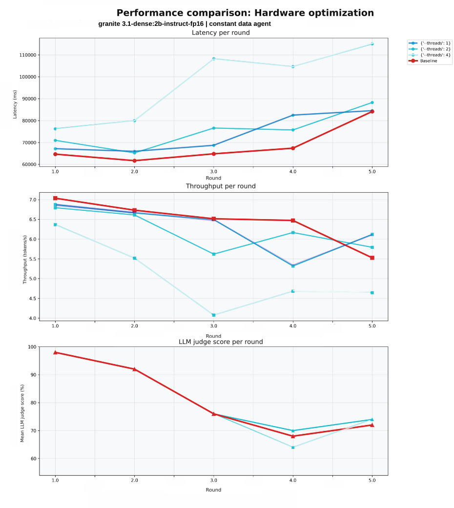

Additional CPU threads do not consistently improve these trajectories. The result is workload- and runtime-specific.

[Archived original source](https://github.com/MariaJastrzebska/praca-magisterska---M.-Jastrzebska/blob/de6eed63d368381e6251ccc6a8c7dd4c756a8976/rysunki/3.3.2.optymaizacja%20inferencji/final_plots/optimisation_impact/hardware.png)

## 18. Combined cache and attention settings

The FlashAttention-containing combination has lower displayed latency. The comparison does not isolate each flag independently.

[Archived original source](https://github.com/MariaJastrzebska/praca-magisterska---M.-Jastrzebska/blob/de6eed63d368381e6251ccc6a8c7dd4c756a8976/rysunki/3.3.2.optymaizacja%20inferencji/final_plots/optimisation_impact/3%20parameters.png)

## 19. Speculative-decoding settings

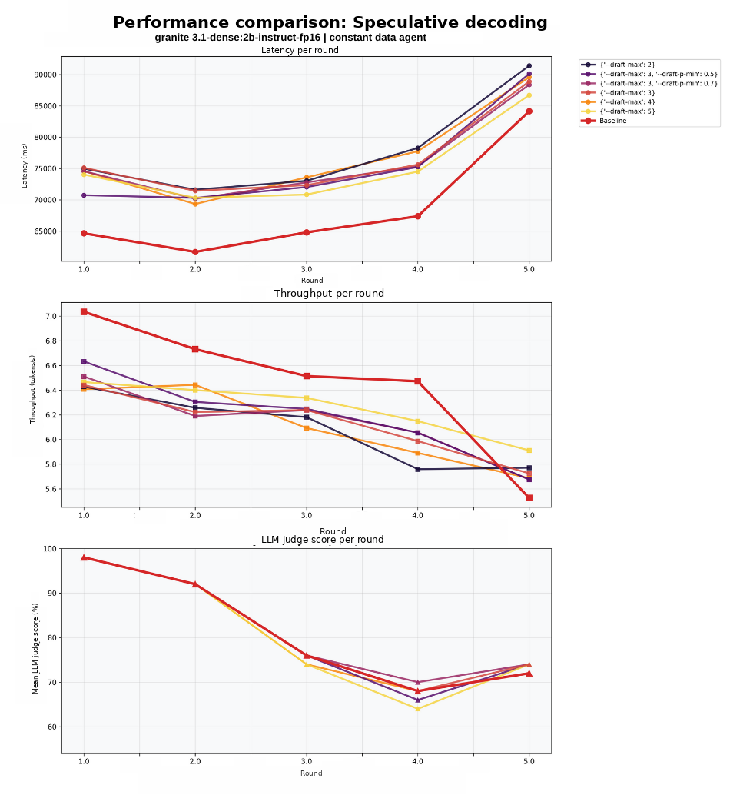

The standalone configurations do not consistently reduce latency against baseline. A favorable combination in another table is not a universal speculative-decoding benefit.

[Archived original source](https://github.com/MariaJastrzebska/praca-magisterska---M.-Jastrzebska/blob/de6eed63d368381e6251ccc6a8c7dd4c756a8976/rysunki/3.3.2.optymaizacja%20inferencji/final_plots/optimisation_impact/speculative.png)

## 20. Cache settings

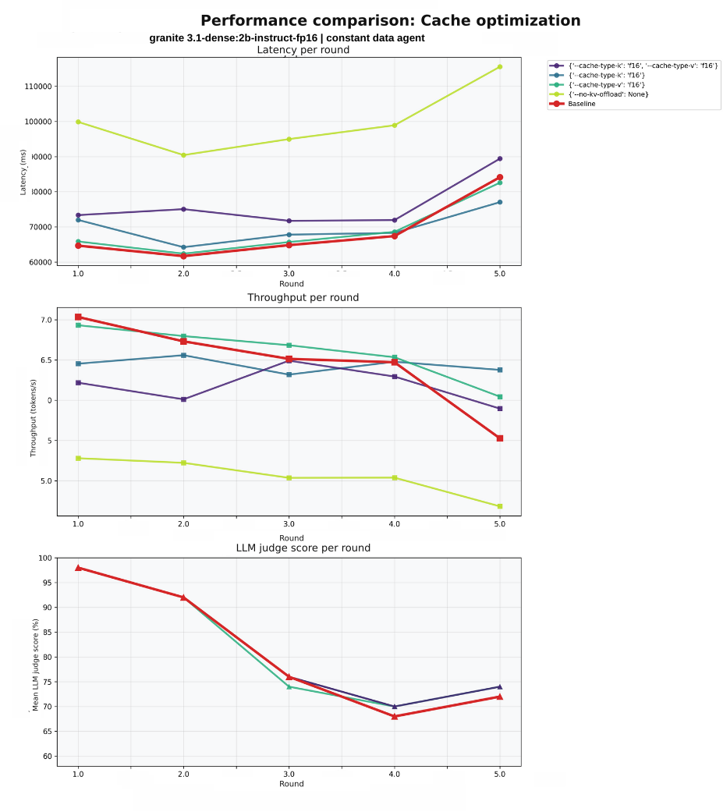

The panels show latency, throughput and judge scores, not a direct cache-memory measurement. f16 is floating-point half precision, not low-bit quantization.

[Archived original source](https://github.com/MariaJastrzebska/praca-magisterska---M.-Jastrzebska/blob/de6eed63d368381e6251ccc6a8c7dd4c756a8976/rysunki/3.3.2.optymaizacja%20inferencji/final_plots/optimisation_impact/cache.png)

## 21. All 46 runtime configurations

Includes prefill/decoding breakdown. Use the separate configuration appendix to decode IDs; aggregate selection is not a confirmatory held-out test.

[Archived original source](https://github.com/MariaJastrzebska/praca-magisterska---M.-Jastrzebska/blob/de6eed63d368381e6251ccc6a8c7dd4c756a8976/rysunki/3.3.2.optymaizacja%20inferencji/final_plots/optimisation_impact/poprawa_all.png)

## 22. Selected favorable configurations

This is a selected subset, so it should be read alongside all configurations. Do not reuse the full-chart IDs without checking the subset mapping.

[Archived original source](https://github.com/MariaJastrzebska/praca-magisterska---M.-Jastrzebska/blob/de6eed63d368381e6251ccc6a8c7dd4c756a8976/rysunki/3.3.2.optymaizacja%20inferencji/final_plots/optimisation_impact/poprawa1.png)

## 23. Later pilot: schema-valid extracted objects

Experiment 005, recorded 12 August 2026, after the earlier status-case fix. A separate object-versus-string inconsistency remains in the source prompt example and saved schema; see the [detailed interpretation](RESEARCH_REPORT.md#august-2026-structured-output-pilot). Counts describe extracted-object validity, not correct arguments.

[Archived original source](https://github.com/MariaJastrzebska/edge-llm-lab/blob/d871920a363acb46a9fb2574f9d5e3fae1d71960/docs/research/figures/structured-decoding-validity.png) · Source repository: `edge-llm-lab`.

## 24. Later pilot: request wall time

Within-model comparisons; output lengths differ between conditions. The means do not isolate grammar-mask overhead.

[Archived original source](https://github.com/MariaJastrzebska/edge-llm-lab/blob/d871920a363acb46a9fb2574f9d5e3fae1d71960/docs/research/figures/structured-decoding-latency.png) · Source repository: `edge-llm-lab`.

## 25. Later pilot: generated tokens

Output work changes with the condition. This provides necessary context for latency and energy changes.

[Archived original source](https://github.com/MariaJastrzebska/edge-llm-lab/blob/d871920a363acb46a9fb2574f9d5e3fae1d71960/docs/research/figures/structured-decoding-tokens.png) · Source repository: `edge-llm-lab`.

## 26. Later pilot: gross package energy

Only requests meeting the coverage criterion contribute. Gemma unconstrained has 52/60 eligible requests; gross energy is not model-only incremental energy.

[Archived original source](https://github.com/MariaJastrzebska/edge-llm-lab/blob/d871920a363acb46a9fb2574f9d5e3fae1d71960/docs/research/figures/structured-decoding-energy.png) · Source repository: `edge-llm-lab`.

## 27. Later routing study: per-case agreement

Recorded 17 October 2026. Each condition matches 12 of 20 references. Zero and 100% bars are descriptive outcomes, not calibrated success probabilities.

[Archived original source](https://github.com/MariaJastrzebska/edge-llm-lab/blob/d871920a363acb46a9fb2574f9d5e3fae1d71960/experiments/results/thread-study-2026-10-17/report/case-scores.png) · Source repository: `edge-llm-lab`.

## 28. Later routing study: per-case request time

One and two threads show heterogeneous differences. Shared-host timing and one pass per condition limit generalization.

[Archived original source](https://github.com/MariaJastrzebska/edge-llm-lab/blob/d871920a363acb46a9fb2574f9d5e3fae1d71960/experiments/results/thread-study-2026-10-17/report/request-cost.png) · Source repository: `edge-llm-lab`.

## 29. Later routing study: paired timing differences

Positive values mean two threads are slower. Differences of case means are shown without uncertainty intervals.

[Archived original source](https://github.com/MariaJastrzebska/edge-llm-lab/blob/d871920a363acb46a9fb2574f9d5e3fae1d71960/experiments/results/thread-study-2026-10-17/report/paired-request-cost.png) · Source repository: `edge-llm-lab`.

## 30. Later routing study: evaluation coverage

All 20 requests per condition were scored. Scored does not mean correct; this chart measures completion of evaluation.

[Archived original source](https://github.com/MariaJastrzebska/edge-llm-lab/blob/d871920a363acb46a9fb2574f9d5e3fae1d71960/experiments/results/thread-study-2026-10-17/report/coverage.png) · Source repository: `edge-llm-lab`.
