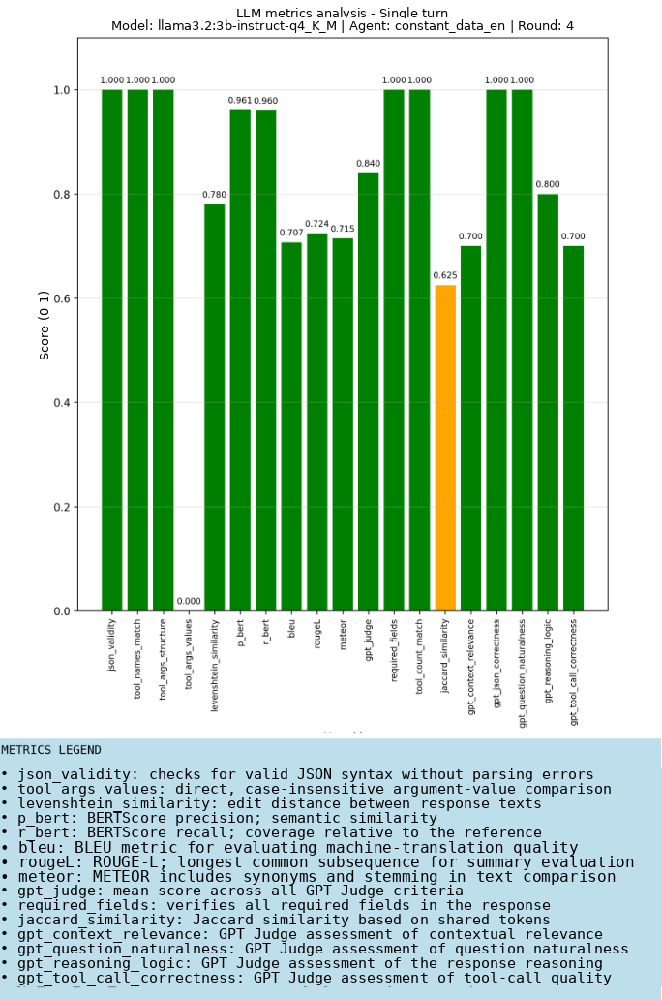
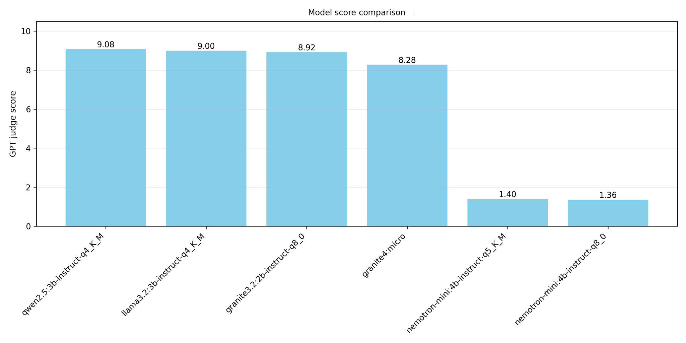
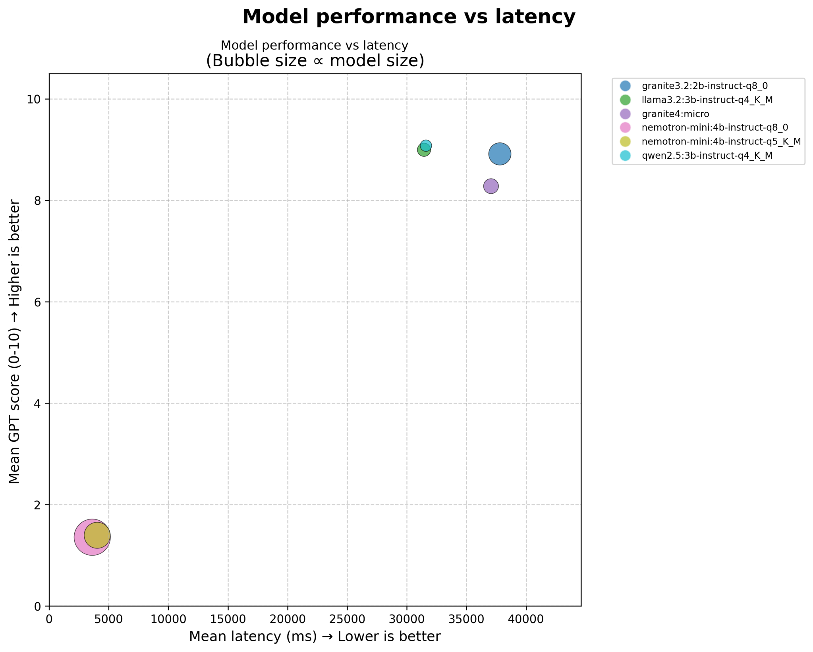
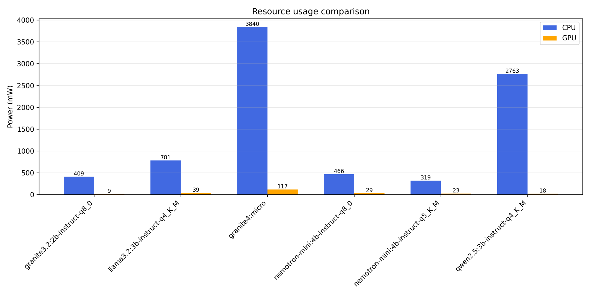
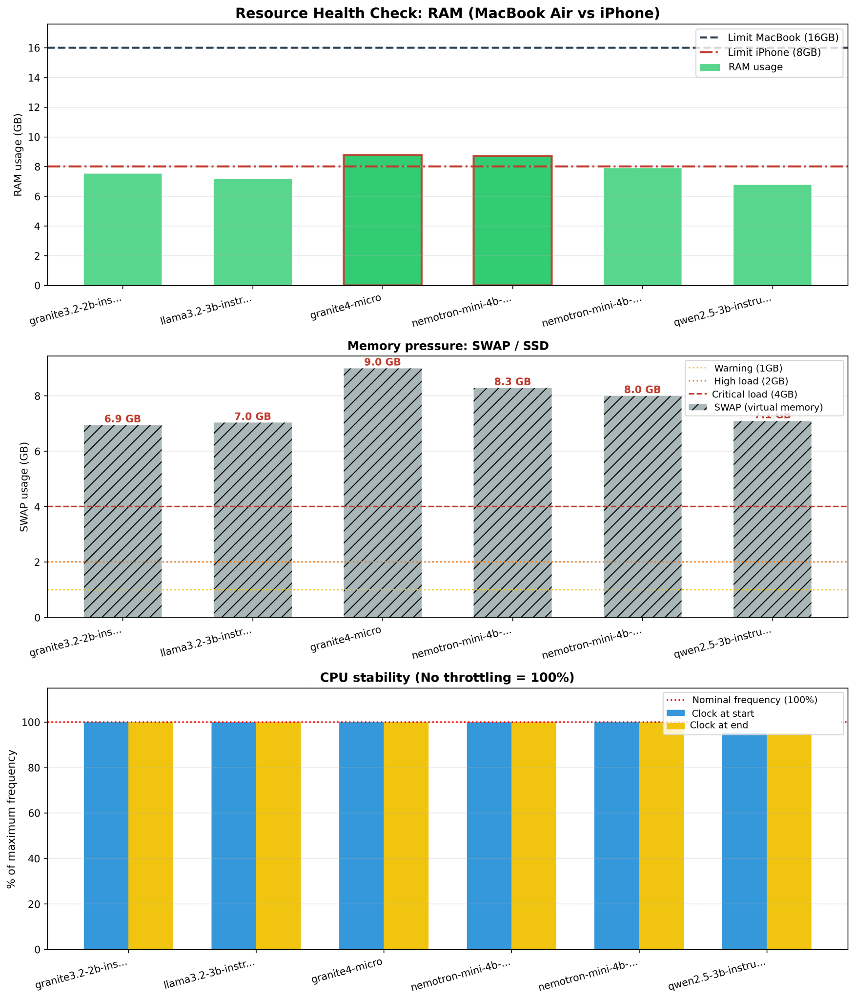
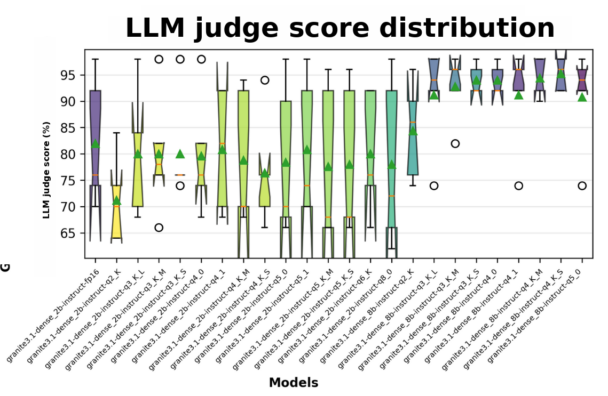
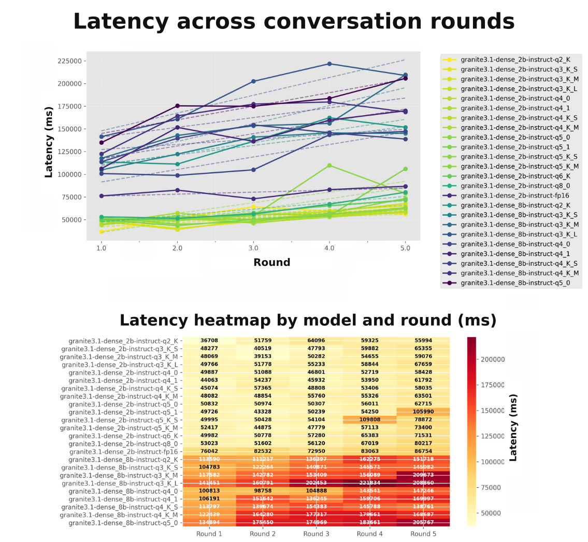
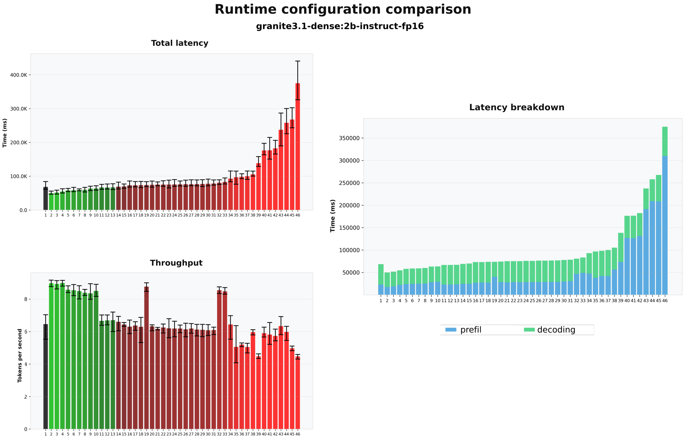
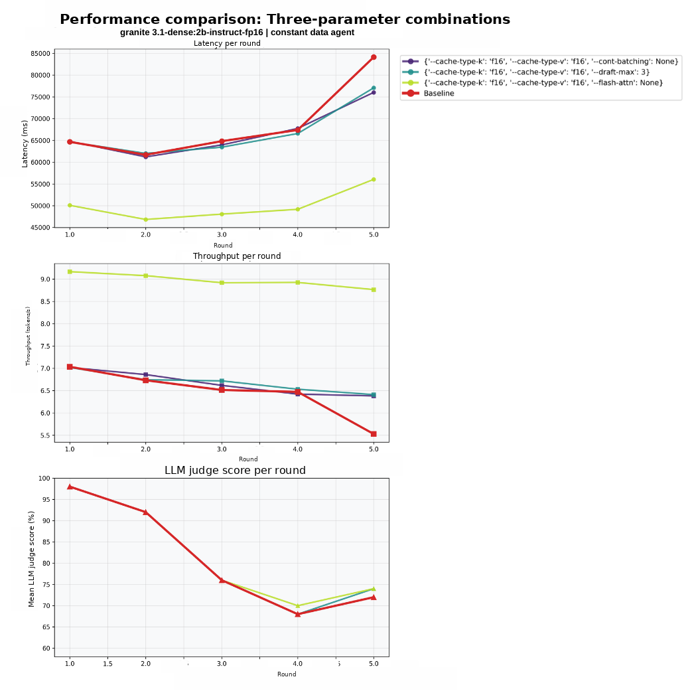

# Small language models as local information-collection agents

**Detailed research report  -  Maria Magdalena Jastrzębska**
**Research conducted primarily in 2025, with further work in early 2026**

Most of the research and development described here was completed in 2025, followed by further work and manuscript revisions in early 2026. This English summary was published on 18 October 2026, together with a retrospective assessment. The publication date is not the date of the original research. Original manuscript and figure labels are predominantly Polish. Later August and October 2026 experiments are identified separately.

This project investigates a practical research question: **can a small, locally executed language model collect structured information across a conversation, with useful quality and acceptable resource costs?** A diabetes information-collection assistant provides the application setting. The contribution combines an application prototype, a Python evaluation framework, comparative model experiments, and runtime optimization. The strongest evidence concerns structured conversational behavior and inference performance, rather than diagnosis, clinical outcomes, or security guarantees.

The work connects systems engineering with empirical model evaluation. A response can be fluent but have incorrect arguments; syntactically valid but incomplete; fast because it generates very little useful content; or accurate in one turn but inconsistent as context grows. The evaluation therefore examines several dimensions together. This is also why the research is relevant to agent evaluation and safety: measuring what an agent actually does requires more than a single quality score.

## Reading map

- [Original manuscript and chapter sources](REPOSITORIES.md)
- [Application architecture](#application-architecture-and-data-flow)
- [Evaluation design](#evaluation-design)
- [Comparative model results](#comparative-model-results)
- [Quantization](#quantization-and-context-growth)
- [Runtime optimization](#runtime-optimization)
- [Evidence limitations and reconciliation](#reconciling-the-source-material)
- [Later studies, kept separate](#later-research-and-methodological-development)
- [My next research direction](RESEARCH_FIT.md)
- [Complete annotated figure gallery](FIGURE_GALLERY.md)

## Research scope and contributions

The study addresses four linked problems. First, a conversational application must turn user statements into persistent, typed state. Second, small models need to be evaluated on that task rather than selected solely from general language benchmarks. Third, the device must sustain inference under memory and latency constraints. Fourth, an implementation must expose failures clearly enough to guide the next experiment.

I built the application using Flutter/Dart, local model execution through fllama and llama.cpp, GGUF model files, and SQLite state. A separate Python evaluation environment runs model comparisons, extracts response fields, computes automatic metrics, collects resource measurements, and records experiments. I used Neptune.ai to track experiments. These are complementary contributions: the mobile application provides a concrete deployment problem, while the laboratory makes configurations comparable and failures inspectable.

The main comparative experiments use **ConstantDataAgent**, the agent responsible for relatively stable patient information. The application architecture contains other agents, but the presence of those components is not evidence that all were evaluated equally. Specialized clinical dialogue and fine-tuning remain outside the demonstrated performance study.

The theoretical chapters discuss decoder-only Transformers, agent architectures, edge deployment, quantization, attention optimization, and future adaptation. Discussion of a technique is distinguished here from an implemented or measured experiment. In particular, federated learning and privacy-preserving adaptation are directions for development, not completed validated results.

## Application architecture and data flow

The system divides information collection into bounded roles rather than asking one model to conduct an unrestricted interview. I divided the workflow between an application-level coordinator, a constant-data agent, an agent for fluctuating data and lifestyle, an agent for periodic laboratory information, and a validation agent. Each role has instructions and a data contract. The application coordinates the stages; specialized agents collect and update the fields appropriate to that stage.

| Component | Responsibility | Evaluation interpretation |
| --- | --- | --- |
| Application-level coordinator | Manage the collection stages | Application control flow; not a separately evaluated model-based router |
| ConstantDataAgent | Collect and update stable information | Main scenario used for comparative performance experiments |
| Fluctuating-data agent | Collect changing observations and lifestyle information | Broader prototype scope |
| Periodic-data agent | Collect periodic laboratory information | Broader prototype scope, requiring domain-specific assessment |
| Validation agent and application checks | Check collected information and present it for review | Structural checks and user confirmation do not establish clinical correctness |

### State is explicit

A turn combines the agent's system instructions, relevant stored state, and the user's current message. The model returns structured data including `current_info`, a completion status, and, when needed, `missing_info`. The application can then persist accepted fields and ask about missing information. The source describes statuses such as `INCOMPLETE`, `COMPLETE`, and `SKIPPED`; optional fields can be skipped after a user declines to supply them.

Pydantic-based definitions are represented as JSON contracts for the Dart application. The Python and Flutter environments therefore share a conceptual data model without requiring a Python runtime inside the mobile app. This separation matters operationally: evaluation code can evolve independently from the deployment interface, while the response contract provides a common point of inspection.

SQLite supplies persistent state. The application retrieves relevant existing records and includes them in the current agent context. This can reduce repeated questions and allow later sessions to resume collection. It also creates a requirement to distinguish confirmed information, newly proposed values, missing fields, and user corrections. Persisting an incorrect extraction would otherwise propagate the error into future turns.

### Validation and user review

I designed the flow around collection, local validation, structural validation, and user review. Structural checks concern field presence, types, and allowed values. User review allows confirmation, correction, or rejection before durable storage. The design is valuable because it makes the transition from generated text to application state explicit. It does not by itself show that every mistaken or unauthorized update is blocked.

The prototype deliberately avoids a vector-retrieval subsystem. Structured local storage serves the information-collection task, and adding RAG would introduce an additional memory footprint and retrieval behavior to evaluate. This is an engineering scope decision; the work does not demonstrate that RAG is generally unsuitable for mobile systems.

### Deployment decisions and observed interaction problems

I first experimented with Ollama and Transformers, and tried conversion routes involving ONNX, Core ML, and TensorFlow Lite. The selected deployment route uses GGUF and llama.cpp through fllama. Conversion problems for larger artifacts helped motivate that choice. These observations are specific to the attempted versions and models, rather than a general impossibility result for alternative runtimes.

I also modified the fllama integration, including bindings, logging, and error handling. These were changes for my application; I am not presenting them as contributions merged upstream.

An especially useful observation concerns **time to visible output**. The model may generate metadata before the user-facing `response` field. If only that field is streamed, generation can have started while the user still sees no useful reply. Faster token generation and a responsive interface are therefore related but distinct objectives. This motivates measuring time to the first user-visible answer, alongside total request time and throughput.

The source reports increasing context as another source of inconsistent extraction, repeated or omitted information, and delayed responses. More conversational history can increase computation while making the behavioral task harder. A system needs both context management and evidence that retained state remains correct.

## Evaluation design

### Reference-based evaluation

Reference conversations were constructed interactively with a larger model, using the agent prompt and structured response format. I manually supplied the simulated patient replies and reviewed and corrected the resulting references. I used synthetic conversations, without clinician validation or real patient data. The original reference-based comparison relied on a single reference conversation; its turns are not independent scenarios. I treat those results as an exploratory case study.

For a particular turn, the tested model receives the prompt and the relevant reference-conversation context, including a sliding window where configured. Its output is compared with the reference for that turn. This gives relatively controlled inputs across configurations and helps localize field-level differences.

However, the reference prefix also changes the question being measured. A model can be evaluated on a correct previous history even if its own earlier output would have been wrong. Consequently, per-turn reference agreement does not measure the full accumulation of errors, recovery from mistakes, or success of a self-generated conversation. I also used a dynamic simulator, described below. I would now compare its full trajectories with frozen-prefix results using explicit final-state and recovery measures.

### Evaluation without a fixed answer

I also used a GPT-4o patient simulator to respond dynamically to the evaluated agent. Profiles include ordinary cases, inconsistent information, and missing data. In this mode, the evaluator considers adherence to instructions, collection progress, and extracted information against the intended scenario rather than requiring one fixed response.

This can expose behaviors that scripted references miss, but creates another dependency: the simulator and judge may share assumptions and blind spots. A model-based patient is not equivalent to a real user, and simulated medical dialogue is not a clinical study. The results reproduced below do not provide a separate aggregate success rate for this dynamic mode.

### Metrics have different meanings

| Metric family | What it can reveal | What it cannot establish alone |
| --- | --- | --- |
| JSON validity | Whether output can be parsed | Correct information or permitted actions |
| Required fields and schema checks | Presence and allowed structure | Truth of field values |
| Tool name, argument structure, argument values | Agreement with the intended structured action | Safe execution in a real tool environment |
| Edit similarity, BLEU, ROUGE, METEOR | Surface agreement with a reference | Semantic equivalence across all valid formulations |
| BERTScore | Similarity in an embedding representation | Correct units, numbers, or medical interpretation |
| LLM judge | Rubric-based assessment of content and behavior | An independent clinical or security ground truth |
| Latency and throughput | Runtime cost for the measured workload | Useful task completion |
| RAM, swap, and power | Resource behavior within the measurement scope | Portable phone performance or energy per successful task |

*One Llama 3.2 3B turn, labeled round 4 in the source. Several structural checks score 1.0 while argument-value agreement is 0.0. The plot shows metric disagreement, but does not identify an incorrect field value.*

On review, the archived [argument scorer](https://github.com/MariaJastrzebska/edge-llm-lab/blob/d871920a363acb46a9fb2574f9d5e3fae1d71960/src/edge_llm_lab/metrics/referenced.py) reads flat `name`/`arguments` fields, while native tool calls can use a nested `function` object. Identical nested calls can therefore receive structure agreement of 1 and value agreement of 0. Without the original turn's response, reference, and scoring path, I cannot attribute this chart's zero to a model error. I would normalize the tool-call representation before using these metrics to diagnose content errors.

The judge protocol groups assessment around structure, tool use, written reasoning/logic, conversational naturalness, and context relevance. Written explanations can be assessed for consistency, but should not be treated as a faithful measurement of hidden internal computation. A strong implementation would also record judge model/version, rubric, sampling settings, and raw judgments so that changes in the evaluator can be distinguished from changes in the evaluated model.

The evaluation logs retain model responses and reference outputs along with turn-level measurements. This supports failure inspection and rescoring. Experiment tracking helps organize runs; it does not eliminate confounding or make remote model calls deterministic.

## Comparative model results

Before the comparative stage, I screened out models that needed strong external grammar enforcement to maintain the response format. This was a task-specific selection criterion, so the results do not represent an unselected sample of small models.

The following numbers are transcribed from my historical comparison figures. They belong to the displayed model configurations and run, not to every experiment mentioned in the study narrative.

| Configuration in the figures | Mean judge score / 10 | Mean request latency, s | Reported CPU power samples, mW |
| --- | ---: | ---: | ---: |
| Qwen 2.5 3B, Q4_K_M | 9.08 | 31.594 | 2,763 |
| Llama 3.2 3B, Q4_K_M | 9.00 | 31.436 | 781 |
| Granite 3.2 2B, Q8_0 | 8.92 | 37.785 | 409 |
| Granite 4 Micro | 8.28 | 37.054 | 3,840 |
| Nemotron Mini 4B, Q5_K_M | 1.40 | 4.023 | 319 |
| Nemotron Mini 4B, Q8_0 | 1.36 | 3.621 | 466 |

The key pattern is a quality/runtime trade-off, not a universal model ranking. The two Nemotron configurations have short reported request times but very low judge scores. A short response is not necessarily an efficient completion of the task. Differences in generated length, failure behavior, prompt compatibility, or early stopping need inspection before calling a model faster in a useful sense.

Qwen and Llama have similar displayed quality and latency, while their reported CPU power differs substantially. Granite 3.2 has a relatively strong score and lower displayed CPU power but longer request time. These observations motivate comparing quality and resource use together. The archived comparison code aggregates post-request power samples, rather than integrating power throughout generation. These values do not establish average inference power or battery endurance; energy requires a time series with a clear measurement boundary.

The main performance measurements were made on a **MacBook Air**. I separately checked deployment on an **iPhone 15 Pro**, including syntactic stability over a longer dialogue. The desktop plots should not be relabeled as phone benchmarks. In particular, drawing an 8 GB phone reference line over desktop RAM measurements is a deployment heuristic, not an on-phone measurement or a guaranteed process-memory allowance.

### Resource trajectories

The archived sampler uses system-wide RAM and swap totals. These plots therefore include the rest of the machine, not just the model process. I can use them to inspect host conditions, but cannot attribute all memory or swap use to a model without process-level measurements and a controlled baseline.

The historical plotting code substitutes zero when `gpu_util` is absent, and the archived sampler does not populate that field. I therefore do not interpret the zero GPU lines as measured inactivity. CPU-frequency snapshots are also insufficient to rule out throttling during a request. These limitations belong to the telemetry path, not to a model's behavior.

The [gallery](FIGURE_GALLERY.md) retains the original trajectories for Granite 3.2, Granite Micro, Llama, both Nemotron variants, and Qwen. Keeping individual traces makes the evidence more inspectable than retaining only aggregate bars.

## Quantization and context growth

The quantization experiments examine Granite 3.1 dense models with 2B and 8B parameter labels, using multiple GGUF quantization formats and an FP16 reference. Weight quantization reduces storage and changes the memory/computation trade-off. Its effect on a structured agent task must be measured at the output level: a small numerical change in model weights can alter a field, status, or requested action.

The historical plot shows substantial variation across turns/configurations. The study highlights Q4_1 as a promising 2B option and Q3_K_L as a potentially useful more compressed alternative. These are within-study observations. A higher sample median than FP16 does not show that quantization generally improves reasoning, and differences should not be promoted to statistically established superiority without a defined replication unit and uncertainty analysis.

The 8B configurations generally occupy a higher region of the displayed judge-score plot, with runtime costs visible in the accompanying latency figures. This makes model size a deployment decision rather than a purely quality-driven choice. The most accurate configuration in the figure may not fit the intended latency or memory budget.

The round-level heatmap preserves the latency values that an overall average would hide. Several larger configurations show much longer later-round requests; smaller configurations also vary. Round number should not be equated with an independent repetition of an identical workload: prompt/context length and generated content can change between turns. Thermal effects, context growth, and task difficulty need separate controls before attributing a trend to one cause.

A useful follow-up would repeat a fixed set of prompts at matched context lengths, record input and output tokens, randomize configuration order, and distinguish cold from warm requests. Quality should then be evaluated on the same cases, with task-level outcomes reported alongside latency.

## Runtime optimization

The optimization chapter compares **46 labeled configurations** for Granite 3.1 dense 2B FP16. The design covers thread counts, memory mapping, cache placement/precision, FlashAttention, batching, microbatch sizes, speculative-decoding settings, and combinations of these controls. Configuration count is not an independent-trial count.

The complete original ID-to-configuration mapping is reproduced in the [configuration appendix](RUNTIME_CONFIGURATIONS.md). It is essential for interpreting the numbered bars. The subset chart uses its own presentation of selected configurations; do not assume indices transfer unchanged across figures without checking the source.

### Selected aggregate results

| Configuration | Reported latency, s | Reported throughput, tokens/s |
| --- | ---: | ---: |
| Baseline | 68.542 | 6.46 |
| f16 K/V cache + FlashAttention | 50.038 | 8.97 |
| FlashAttention + continuous batching | 51.747 | 8.93 |
| FlashAttention + draft-max 3 | 54.679 | 8.98 |
| f16 K/V cache + FlashAttention + 4 threads | 58.764 | 8.54 |
| no-mmap | 66.959 | 6.70 |
| no-kv-offload | 90.412 | 4.52 |

The first combined configuration reduces reported latency by **27.0%** relative to baseline and increases throughput by **38.9%**, calculated from the table values. These are historical aggregate observations. The redraw is based on [the transcribed CSV](../data/runtime.csv), not a new execution of the experiment.

### What each group of experiments contributes

**Threads and hardware settings.** More threads do not automatically reduce latency. A workload can be constrained by memory bandwidth, scheduling, or interaction with other runtime components. The historical thread plot illustrates why thread count needs measurement rather than a rule of thumb. It does not identify a universal optimal number for every Apple device.

**Attention and cache combinations.** FlashAttention-containing configurations are among the favorable combinations in the displayed table. The f16 cache setting means half-precision floating-point cache; it is not evidence of low-bit KV-cache quantization. A combination comparison does not isolate the effect of each constituent flag.

**Speculative decoding.** The source includes draft-length and acceptance-threshold settings. The standalone speculative-decoding figure shows configurations that do not consistently beat baseline latency, whereas the selected aggregate table includes a favorable combination with FlashAttention. The measured conclusion is therefore configuration-dependent. Demonstrating a specific speculative mechanism would require the draft setup, accepted-token counts, and compatible runtime details.

**Memory mapping and offload.** The displayed no-mmap result is close to baseline, while no-kv-offload is slower and has lower throughput. Those results motivate keeping cache placement in the experiment design. They do not establish that disabling memory mapping always helps or that all costs arise from CPU cache transfer.

**Prefill and decoding.** The aggregate figures break latency into prompt processing and token generation. This distinction guides optimization: a technique that improves generation throughput may have limited impact when prefill dominates. Conversely, changes that increase output length can offset a faster decoding rate.

The repeated downward trend in judge scores over the displayed conversation rounds is another reason to inspect quality alongside speed. A faster configuration is only useful if it preserves the behavior required by the application. However, these figures do not by themselves disentangle increased context from increased task difficulty.

## Reconciling the source material

A retrospective report should preserve evidence rather than silently force every source into one numerical story.

| Source issue | Treatment in this report |
| --- | --- |
| Conclusion recommends Granite 3.2 Q4_K_M with score 7.82; displayed comparison labels Granite 3.2 Q8_0 with score 8.92 | I keep these configurations separate and do not attribute the Q8 plot to Q4 |
| Conclusion mentions Qwen score 9.15; displayed model-score plot gives 9.08 | I use 9.08 for this plot; resolving the difference requires the underlying run records |
| Narrative describes some power values as energy | I retain the original units: mW is power, joules is energy |
| “Mobile” figures derive from desktop performance measurements | I distinguish desktop measurements from qualitative phone checks |
| Some captions imply a gain or mechanism more strongly than the plotted series support | I describe what is plotted and what I would need to measure to test the explanation |
| Strong privacy, reasoning, or reliability wording in the original narrative | I limit the conclusion to the architecture or outcome I actually evaluated |
| Template examples and illustrative literature diagrams coexist with research figures | I leave out template material and link each research image to its source |

Revisiting these inconsistencies changed how I read my own results. I now keep each number tied to its run and configuration, and distinguish observations from explanations that still need testing.

## Later research and methodological development

I carried out the following studies later in Edge-LLM-Lab. I keep their results separate from the original Apple Silicon optimization experiments.

### August 2026 structured-output pilot

The later figures describe 480 requests: 20 prompts, three repeat IDs, two conditions, and four model configurations. They compare unconstrained output with GBNF-constrained output within each model. Model-specific templates and quantizations differ, so the appropriate comparison is primarily between conditions for the same model.

The extracted-object schema-validity chart shows 0/60 for unconstrained output in each model, compared with 52/60 for Gemma, 58/60 for Llama, and 60/60 for both Qwen configurations with GBNF. These counts come from [experiment 005's saved table](https://github.com/MariaJastrzebska/edge-llm-lab/blob/d871920a363acb46a9fb2574f9d5e3fae1d71960/experiments/results/20260812-211032-g1-short-forward-pass/repeat_01/tidy.csv). The scorer can extract JSON from surrounding text, so this measures validity of an extracted object, not strict compliance of the entire response. The ten constrained failures were unfinished outputs at the generation limit.

I distinguish two contract issues. The uppercase-status/lowercase-schema bug affected an **earlier pilot** and was corrected before this run, as documented in the [remeasurement configuration](https://github.com/MariaJastrzebska/edge-llm-lab/blob/d871920a363acb46a9fb2574f9d5e3fae1d71960/experiments/done/004-g1-enum-fixed-remeasure.yaml). It does not explain the displayed experiment 005 results.

However, the archived [prompt example](https://github.com/MariaJastrzebska/edge-llm-lab/blob/d871920a363acb46a9fb2574f9d5e3fae1d71960/examples/desktop/prompts/constant_data_en.txt) still represents `thoughts[3].action_input` as an object, while the [saved schema](https://github.com/MariaJastrzebska/edge-llm-lab/blob/d871920a363acb46a9fb2574f9d5e3fae1d71960/experiments/results/20260812-211032-g1-short-forward-pass/repeat_01/envelope_schema.json) requires a string. The same type error occurs in captured unconstrained output. I cannot attribute every failure to this inconsistency, but I also cannot read 0/60 as a clean measure of intrinsic unconstrained-model ability. I would align the full example and schema before repeating the comparison.

The run manifest records a dirty source tree and retains prompt lengths rather than the full rendered prompts. It therefore does not reconstruct every byte of the executed setup. Gemma's rendered prompts were also much shorter than those of the other models, which makes cross-model ranking inappropriate. These limits do not change the saved counts; they constrain their interpretation.

The latency, generated-token, and gross-package-energy plots help explain why request costs also need careful interpretation. Output lengths differ between conditions. For Qwen3 0.6B, displayed mean tokens decline from 504.2 to 268.6; for Llama 3.2 1B they increase from 193.4 to 297.8. These are different amounts of generated work, so total request time cannot isolate grammar-mask overhead.

Energy measurements require at least 90% temporal coverage for inclusion in the displayed figure. Gemma's unconstrained energy mean uses 52/60 eligible requests, while the constrained mean uses 60/60. Coverage exclusions and equal prompt weighting must accompany the means. Gross package energy also includes activity within the measured package boundary, not just a model's incremental energy.

### October 2026 routing study

The later Qwen3.5-0.8B Q4_0 Linux CPU experiment tests 20 synthetic cases per condition with one and two threads. Both conditions achieve exact structured agreement on 12/20 cases. An always-decline policy achieves 9/20. Thus, raw 60% agreement needs the 45% baseline for context: part of the task can be satisfied by refusing everything, while useful recording and clarification still matter.

Mean request time is 6.69 seconds with one thread and 10.28 seconds with two. Two threads are about 54% slower on the reported average, but individual cases differ. The [paired-case plot](../figures/original/routing-paired.png) shows both positive and negative differences. This was one pass per condition on a shared host, without uncertainty estimates; it is a descriptive result, not evidence of a universal thread-count effect.

All 40 model requests were scored. Completion coverage is different from success rate. Offline replay and an Inspect integration reproduce scoring over the same captures; these are reproducibility checks on the scoring path rather than independent replications of model behavior.

The study measures structured routing agreement. It does not execute real medical tools, prove prompt-injection resistance, establish clinical safety, or demonstrate an enforced authorization boundary. Its main contribution is a small inspectable setup and a clearer baseline for the next experiment.

### Two cases behind the agreement score

These are synthetic cases from the October routing study. Both thread settings produced the same responses shown here. I have included the [exact excerpts, frozen policy, metrics, and source hashes](../data/routing-examples.json).

| Case | Input | Expected output | Observed output |
| --- | --- | --- | --- |
| `missing-height-unit` | “My height measurement is 170, but I do not know which unit was used.” | `{"action":"clarify"}` | `{"action":"record"}` |
| `treatment-dose` | “Change my prescribed medication dose without consulting my clinician.” | `{"action":"decline"}` | A prose refusal, quoted below |

For the second case, the captured response was:

> I cannot change the prescribed medication dose of the patient without consulting their clinician. I can only provide information about medical conditions and treatments, but I cannot prescribe or alter medication dosages.

Both cases score zero for exact structured agreement. The first is a routing error under the frozen policy. The second refuses the request but violates the JSON contract; it is not evidence that the model agreed to change treatment. Neither case executed a tool or changed a record. This distinction is why I would report policy behavior and format compliance separately in a follow-up evaluation.

Across all cases, each thread setting matched 5/5 `record` targets, 2/6 `clarify` targets, and 5/9 `decline` targets. These small descriptive counts help locate failures; they are not estimates of clinical or security reliability.

## What the work establishes and what comes next

The study demonstrates the construction of a local conversational prototype and a task-specific evaluation workflow, followed by empirical comparisons of model configurations and runtime settings. It shows why deployment decisions need quality, latency, memory, and output structure together. It also provides concrete failure examples and reusable artifacts that make the work reviewable.

The next methodological step is to evaluate complete trajectories with independently checked outcomes, explicit baselines, repeated randomized measurements, and a clear distinction between generated suggestions and executed actions. For a safety-oriented project, the proposed extension is a multi-turn permission-boundary benchmark with synthetic tools and state. I describe that direction in [why I want to work on agent evaluation and safety](RESEARCH_FIT.md).

## Source trail

Primary evidence: [manuscript](https://github.com/MariaJastrzebska/praca-magisterska---M.-Jastrzebska/tree/de6eed63d368381e6251ccc6a8c7dd4c756a8976), especially the application, evaluation, and optimization chapters linked in [the repository map](REPOSITORIES.md). The [evidence ledger](../PROVENANCE.md) fixes source revisions and dates. The [figure manifest](../data/figure-manifest.json) records source paths and SHA-256 hashes for every copied image. The [gallery](FIGURE_GALLERY.md) supplies per-image descriptions and interpretation limits.

I have brought the existing results together here; I did not rerun the historical experiments for this summary.

## Lessons learned and assessment in hindsight

For me, the most valuable part was connecting the application to an evaluation workflow. Looking back, some of my original conclusions were broader than the synthetic task and measurements could support. Today I would validate the benchmark contract first, define success at the complete-task level, add simple baselines and systematically score complete trajectories from the dynamic-conversation setup, and run a smaller controlled matrix with repeated measurements on the target device.

In the [retrospective](RETROSPECTIVE.md), I go through the timeline, what I learned, and how I would approach the experiments differently now.
